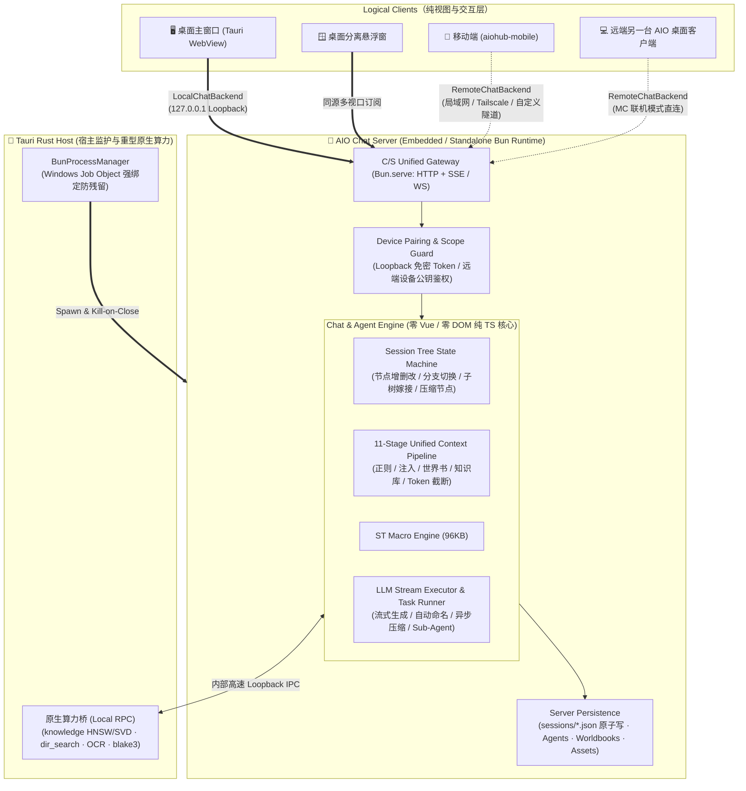

# LLM Chat 类 Minecraft 服务端/客户端（C/S）架构与内嵌 Bun 运行时设计

> **状态**：架构设计草案（2026-11-02）
> **关联文档**：
> - [`src/tools/llm-chat/ARCHITECTURE.md`](../../src/tools/llm-chat/ARCHITECTURE.md)
> - [`docs/design/地基迁移调查/webview2-migration-investigation.md`](./地基迁移调查/webview2-migration-investigation.md)
> - [`docs/design/mobile-desktop-companion-connection-concept.md`](./mobile-desktop-companion-connection-concept.md)
> - [`docs/design/mobile-desktop-interoperability-research.md`](./mobile-desktop-interoperability-research.md)

---

## 1. 核心命题：为什么走向「Minecraft 式 C/S 架构 + 内嵌 Bun」？

当前 `llm-chat` 的核心业务状态机（多叉树会话、11 级上下文管道、96KB 宏引擎、流式请求执行器、自动压缩与异步任务）全部运行在前端 WebView 渲染进程的 Vue/Pinia 上下文中。这在桌面多窗口、移动端互通以及后台长任务场景下暴露了两个根本矛盾：

1. **多端同步合并（Sync & Merge）在非线性对话树上是死胡同**：
   AIO Hub 的会话并非简单的线性文本列表，而是带 `parentId` / `childrenIds` / `activeLeafId`、包含子树嫁接、非破坏性压缩节点、正则快照绑定、本地资产占位符（`【file::assetId】`）以及关联向量缓存的复杂有向树。若采用“多端各自修改本地库 + WebDAV/Git 双向合并”的传统同步路线，任何并发的分支切换、后台自动压缩或子树重排都会引发无法自动消解的拓扑冲突。
2. **UI 窗口生命周期与 Agent 核心运行时强绑定**：
   如《WebView2 瓶颈与引擎迁移调查报告》所实测，将重度流式生成与工具调用放在渲染进程中，会导致关闭窗口即中断任务、HMR/刷新丢失运行态、多窗口所有权混乱；而尝试用隐藏 `Background WebView`（`background-js.html`）打补丁，不仅继续承受 WebView2 的内存黑盒与后台节流（Throttling），且无法脱离桌面 GUI 独立部署。

### 1.1 Minecraft (1.3+) 架构范式的启示

Minecraft 自 1.3 版本起彻底废除了“单机一套逻辑、联机另一套逻辑”的割裂设计，转为 **Integrated Server（内置逻辑服务端）+ Logical Client（纯视图客户端）**：

- **单人模式（Local World）**：客户端在本地后台静默拉起一个 Integrated Server，UI 层仅作为连接本机 Loopback 的 Client 运行。
- **联机/远程模式（Remote World）**：UI Client 断开本机 Server，通过网络直接连向远端主机的 Server（另一台开启局域网开放的主力机，或 24 小时运行的无头 Dedicated Server）。
- **存档主权物理隔离（零合并冲突）**：每台设备保有自己的“本机存档（Standalone）”；当切换到远端主机时，客户端直接读写远端世界的会话树、模型渠道与智能体，本地只维护 IM 式的视图投影缓存与草稿。跨端转移数据仅通过显式的“导入/导出会话或角色包”完成，从根源上消灭双向同步合并。

### 1.2 破除「Tauri 内嵌 JS 运行时 = Fabric 装 Forge」的心理误区

在 Tauri 语境下引入独立 JS 运行时（Bun）之所以容易产生“在 Fabric 上硬套 Forge 兼容层”的别扭感，源于将 Tauri 误读为“后端必须 100% 纯 Rust”的教条。

事实上，对比 `OpenCode`（Rust 层为 0 业务的纯空壳）或 `TauriTavern`（强行用 Rust 硬写动态酒馆业务导致编译缓慢、`serde` 频繁因旧角色卡字段缺失而崩溃），AIO Hub 的真实架构定位更接近 **现代游戏引擎（Native 重型底座 + 脚本虚拟机）**：

| 层级 | 运行时载体 | 核心职责与天然优势 |
| :--- | :--- | :--- |
| **系统外壳与重型算力层** | **Tauri (Rust)** | 窗口管理（Mica/Acrylic、`wry` 拖放增强）、7 大重型原生模块（`knowledge` 163KB HNSW/SVD 向量引擎、`dir_search` 并行搜索、`content_deduplicator` BLAKE3 流式哈希、`system_pulse`、`ocr`、`external_player`、`native_plugin`）及子进程生命周期监护。 |
| **对话编译器与状态机层** | **Embedded Bun (TS)** | 运行 11 级 `Unified Context Pipeline`、96KB `macro-engine`、多叉树拓扑管理、LLM 流式请求调度、Sub-Agent 循环与 C/S 网关协议。**零 Cargo 编译等待、100% 保持动态 Schema 与脚本灵活性**。 |
| **视口与交互渲染层** | **Vue 3 WebView / Mobile** | `RichTextRenderer` (RTR) AST 增量渲染、D3/VueFlow 会话树图谱、CodeMirror 6 输入系统、分离悬浮窗。 |

这不是“Fabric 套 Forge”，而是 **Rust 原生引擎挂载其最顺手的动态逻辑协处理器**。

---

## 2. 为什么内嵌 Bun 是最优解？

对比其他后端运行时方案，内嵌 Bun（`bun.exe` Sidecar / 独立 Server 双模）同时解决了桌面端历史包袱与跨端演进需求：

1. **直接复用现有 TS 核心，零重写成本**：
   `src/tools/llm-chat/core/context-processors/`（11 级管道）与 `macro-engine/`（96KB 宏引擎）本身就是纯 TypeScript 逻辑，在 Bun 下无需任何转译即可直接原生执行。
2. **原生基建开箱即用（`Bun.serve` + `bun:sqlite`）**：
   - `Bun.serve` 原生提供极高性能的 HTTP REST + WebSocket + SSE 一体化服务，直接作为 C/S 架构的统一网关；
   - `bun:sqlite` 零 C++ `node-gyp` 编译依赖，完美契合客户端/服务端结构化索引与缓存需求。
3. **顺手消灭 45KB 的 Rust 网络代理“入狱税”**：
   此前为了绕过 WebView2 `fetch` 不支持跳过自签名证书校验（`relaxIdCerts`）、不支持强制 HTTP/1.1、CORS 拦截及大图 Base64 IPC 阻塞，被迫在 Rust 端维护了合计约 45KB 的 `llm_proxy.rs` 与 `llm_inspector.rs`。迁移至 Bun Server 发起上游 LLM 请求后，Bun 原生 `fetch` 直接支持 `tls: { rejectUnauthorized: false }`、流式直通与自定义 Header，彻底摆脱浏览器沙箱掣肘。
4. **天然支持「桌面内嵌」与「无头独立部署（Dedicated Server）」双形态**：
   同一套 `@aiohub/chat-server` 代码：
   - 在桌面端由 Tauri Rust 主进程作为受控后台子进程静默拉起（Integrated Server）；
   - 在 Linux 云服务器、NAS 或宿主机命令行下，可直接通过 `bun run packages/chat-server` 独立无头运行（Dedicated Server），无需安装任何 GUI 或 WebView 环境。

---

## 3. 总体架构拓扑



---

## 4. 核心模块职责与剥离边界（基于现有源码对齐）

为了避免“在高速公路上换发动机”引发全局瘫痪，我们将现有 `src/tools/llm-chat/` 拆分为 **Server 权威层（下沉至 Bun）** 与 **Client 视图层（留在 Vue）**。

### 4.1 模块去留与迁移矩阵

| 现有源码目录 / 文件 | 目标归属 | 耦合现状与剥离改造方案 |
| :--- | :--- | :--- |
| `core/context-processors/*`<br/>（11 级上下文处理器） | **Bun Server** | **95% 纯净**。仅需将其中读取知识库/文件的调用替换为通过 `ServerHostBridge` 调本地文件或 Rust 向量接口。 |
| `macro-engine/*`<br/>（96KB 动态宏引擎） | **Bun Server** | **98% 纯净**。纯字符串与虚拟时间计算，仅 `system` / `assets` 宏需注入服务端环境上下文。 |
| `services/sessionPersistenceRepository.ts`<br/>`services/sessionPersistenceCoordinator.ts` | **Bun Server** | **需替换 IO 底座**。当前依赖 `@tauri-apps/plugin-fs`；下沉至 Bun 后直接改用 `node:fs/promises` 与 `Bun.file`，保留现有的 `.tmp` 原子写入、`.bak` 备份回退与 `_persistence.revision` 校验机制。 |
| `services/requestSnapshot*.ts`<br/>`core/context-utils/preview-builder.ts` | **Bun Server** | 上下文 X 光分析器（`context-analyzer`）由客户端发起预览查询请求，Server 跑完管道后返回结构化 `ContextPreviewData` 快照。 |
| `composables/session/useNodeManager.ts`<br/>`composables/session/useBranchManager.ts` | **Bun Server** | **核心剥离点 1**：剥离 Vue `ref`/`computed` 包装，转化为纯 TS 的 `SessionTreeManager` 类，负责节点追加、原地编辑、分支切换、子树嫁接（`reparentSubtree`）及 50 步 Undo/Redo 栈。 |
| `composables/chat/useChatExecutor.ts`<br/>`services/llmChatService.ts` | **Bun Server** | **核心剥离点 2**：彻底移除对 `useLlmChatUiState()`、`useChatInputManager()` 和 `customMessage` 的直接引用（详见 4.2 节）。所有生成任务交由 Server 端 `ChatTaskRunner` 独立管理。 |
| `services/chatStreamReceiver.ts` | **Vue Client** | **现成利器直接复用**！该类已实现基于 UTF-16 `offset` 的流式增量（`ChatStreamingDelta`）拼接与定期权威快照（`ChatSessionDetail`）的无损对账，天然适合作为客户端接收 Server SSE/WS 流的对账引擎。 |
| `components/*`（1.24MB UI）<br/>`composables/visualization/*`<br/>`composables/input/*` | **Vue Client** | **100% 留在客户端**。包含 RTR 渲染容器、D3/VueFlow 关系图、CodeMirror 输入框、草稿与虚拟附件组装。 |

### 4.2 斩断 UI 隐式耦合：从「读全局 Store」到「显式 Command DTO」

当前 `src/tools/llm-chat/services/llmChatService.ts` 的 `sendMessage` 存在典型的“前端单机假设”：
- 当 `options.sessionId` 缺失时，隐式读取 `store.currentSessionId`；
- 当需要新建会话时，隐式读取 `useLlmChatUiState().currentAgentId.value`；
- 隐式读取 `this.inputManager.temporaryModel.value`；
- 报错直接触发前端 `customMessage` Toast。

在 C/S 架构下，无论是本机主窗口、本机分离窗还是远端手机客户端，向 Server 发起的任何写操作都必须是 **自包含、无 UI 歧义、幂等的 Command DTO**：

```ts
export interface SendChatTurnCommand {
  /** 客户端生成的幂等请求 ID，防断网重连重复扣费/重复生成 */
  operationId: string;
  /** 显式目标会话 ID（若为新建草稿会话则传预分配 ID 或 createIfMissing） */
  sessionId: string;
  /** 显式挂载的父节点 ID（决定在多叉树的哪个分支下生长，绝不依赖服务端猜测“当前激活叶节点”） */
  parentId: string;
  /** 本轮使用的智能体 ID */
  agentId: string;
  /** 显式模型覆盖（取代原 inputManager.temporaryModel 隐式读取） */
  modelOverride?: ModelIdentifier | null;
  /** 用户输入正文 */
  content: string;
  /** 已上传或已注册至当前 Server 的资产 ID 列表 */
  attachmentIds?: string[];
  /** 选项开关 */
  disableMacroParsing?: boolean;
  delegationDepth?: number;
}
```

---

## 5. 客户端抽象：可切换 `ChatBackend` 与多世界隔离

客户端（桌面端 WebView 与移动端 `aiohub-mobile`）复用同一套 UI 组件，通过 `ChatBackend` 接口连接不同的逻辑世界（类比 Minecraft 主菜单的「单人游戏 = 本机内置服」与「多人游戏 = 远端服务器列表」）。

### 5.1 统一 `ChatBackend` 领域接口

```ts
export interface ChatBackend {
  readonly backendId: string; // "local" 或配对桌面的稳定 desktopId
  readonly kind: "integrated-local" | "remote-server";
  readonly status: ReadonlyRef<"disconnected" | "connecting" | "connected" | "degraded">;

  // 会话与多叉树查询
  listSessions(query?: SessionListQuery): Promise<SessionsIndexProjection>;
  getSessionSnapshot(sessionId: string): Promise<ChatSessionDetail>;
  
  // 树拓扑与消息意图（返回修订号 revision 与关联 taskId）
  sendChatTurn(cmd: SendChatTurnCommand): Promise<TurnAcceptedReceipt>;
  abortGeneration(sessionId: string, nodeId?: string): Promise<void>;
  mutateTree(sessionId: string, mutation: TreeMutationCommand): Promise<TreeMutationResult>;
  
  // 上下文工程与预览
  buildContextPreview(sessionId: string, targetNodeId: string): Promise<ContextPreviewData>;

  // 资产与流式订阅
  resolveAssetUrl(assetId: string): string;
  uploadAsset(file: Blob | File, meta?: AssetUploadMeta): Promise<Asset>;
  subscribe(cursor: string | null, handler: (event: ServerEvent) => void): UnsubscribeFn;
}
```

### 5.2 本地模式 vs 远端模式的行为同构与隔离

| 维度 | 本机内置服 (`IntegratedLocalBackend`) | 远端服务器 (`RemoteServerBackend`) |
| :--- | :--- | :--- |
| **物理连接目标** | 本机 Tauri 拉起的内嵌 Bun（`http://127.0.0.1:{port}`） | 局域网 / Tailscale 虚拟网 / 独立部署的远端 Bun Server |
| **鉴权方式** | Tauri 启动时生成的进程内 Ephemeral Token 自动注入 | 首次二维码/配对密钥握手，签发带 `DeviceScope` 的设备凭据 |
| **数据主权** | 直接读写本机 `appConfigDir/llm-chat` 正式存档 | 权威数据在远端主机；客户端按 `backendId` 隔离存储 SQLite/IndexedDB 视图缓存、未发送草稿与阅读位置 |
| **资产解析 (`agent-asset://` / `【file::id】`)** | 走本地文件协议或本地回环流 | 自动重写为 `https://{endpoint}/api/v1/assets/{assetId}?token=...` 受控流 |
| **断线/切后台恢复** | WebView 刷新或关窗重开后，凭 `cursor` + `ChatStreamReceiver.snapshot()` 瞬间续接正在生成的流 | 手机切后台/断网期间远端 Bun 继续跑完 LLM 生成与工具调用；重连后拉取增量事件或最新节点快照 |

---

## 6. 流式同步与断线重连协议（基于 `ChatStreamReceiver` 演进）

AIO 现有的 `src/tools/llm-chat/services/chatStreamReceiver.ts` 已经实现了一个极为精巧的设计：**流式 Delta 携带绝对 UTF-16 偏移量（`offset`）与 `requestStartTime`，并能与周期性到达的完整 `ChatSessionDetail` 快照自动对齐合并**。

在 C/S 架构下，我们将这一机制直接升级为标准网络事件流协议（SSE 或 WebSocket）：

1. **序号与游标（`eventSeq` / `cursor`）**：
   Bun Server 维护单调递增的环形事件缓冲区（Ring Buffer，例如保留最近 5,000 条结构化事件）。每条事件携带全局 `seq`。
2. **三类核心推送事件**：
   - `stream.delta`：负载即现有的 `ChatStreamingDelta`（`{ sessionId, nodeId, delta, isReasoning, offset, requestStartTime }`），客户端直接喂给 `ChatStreamReceiver.receive(delta)`。
   - `session.snapshot`：当树拓扑发生变化（新增节点、切换分支、完成生成、自动压缩完成）或客户端出现 `offset` 缺口请求补偿时，推送带 `_persistence.revision` 的 `ChatSessionDetail`，客户端调用 `ChatStreamReceiver.snapshot(detail)` 无缝抹平差距。
   - `task.state`：后台任务（自动标题生成、上下文压缩、Sub-Agent 执行、工具审批等待）的状态变更。
3. **重连自愈闭环**：
   - 客户端重连时携带 `Last-Event-ID: {lastSeq}`；
   - 若 `lastSeq` 仍在 Server 环形缓冲区窗口内，Server 顺序重放缺失事件；
   - 若客户端离线过久或 Server 重启导致 `cursor` 过期，Server 返回 `cursor.expired` 标记，客户端立即对当前打开的 `sessionId` 拉取一次 `getSessionSnapshot` 并喂给 `ChatStreamReceiver.snapshot()`，实现 0 闪烁恢复。

---

## 7. Rust 宿主与内嵌 Bun 的进程协同规范

在桌面端 Tauri 环境中，为确保内嵌 Bun 既具备独立进程的抗崩溃与后台存活能力，又绝不沦为脱离管控的孤儿进程，Rust 侧（`src-tauri`）需实现严格的 `BunRuntimeManager`：

### 7.1 生命周期与防僵尸进程绑定（Windows Job Object）

- **启动握手**：Tauri 启动时，Rust 选择空闲回环端口（或 Named Pipe），生成 256-bit 随机 `INTERNAL_HOST_TOKEN`，拉起内置的 `bun` 可执行文件运行 `@aiohub/chat-server`。
- **内核级强绑定**：
  - **Windows**：创建 `JobObject` 并设置 `JOB_OBJECT_LIMIT_KILL_ON_JOB_CLOSE` 标志，将 Bun 子进程句柄加入该 Job。哪怕 Tauri 主进程被任务管理器强杀或发生 Panic 崩溃，Windows 内核也会在 0 毫秒内强制回收 Bun 进程树，彻底杜绝残留进程占用端口或锁死数据库。
  - **macOS / Linux**：结合 `prctl(PR_SET_PDEATHSIG, SIGTERM)` 与进程组看门狗（监控父进程 PID / stdin 管道闭合）。
- **窗口关闭不中断服务**：当用户关闭桌面主窗口但应用驻留系统托盘时，WebView 销毁释放数百 MB 至数 GB 渲染内存，而 Bun Server 进程仅占用数十 MB 内存继续在后台完成正在进行的 Agent 循环与远端 Companion 服务。

### 7.2 Bun 调用 Rust 7 大重型原生算力（Local Compute Bridge）

Bun 负责业务编排，但遇到高密度 CPU/系统级任务时，不应在 JS 里重复造轮子，而是通过本地回环接口回调 Rust 原生模块：

- **知识库向量检索**：Bun 的 `knowledge-processor` 在执行第 7 级管道时，直接通过本地高速通道调用 Rust 的 `knowledge` 模块（HNSW 检索、SVD 投影、jieba 分词与 `kb_retrieval_cache_*` 全局缓存）。
- **高性能目录搜索与去重**：Agent 调用 `dir-search`、`directory-tree` 或 `content-deduplicator` 时，由 Bun 转发至 Rust 执行器处理。
- **跨端工具路由（Server Tool vs Client Tool）**：
  - 默认工具在 Server 所在主机执行；
  - 当远程客户端（如手机或另一台笔记本）连接时，客户端可在握手阶段向 Server 声明挂载 `client-local` 级工具（如“读取客户端当前剪贴板”、“拍摄手机照片上传”），Server 在工具调度层按工具归属路由。

---

## 8. 远程开放与安全边界（对齐 Companion 规范）

当用户仅在桌面单机使用（默认状态）时，Bun Server **严格只绑定 `127.0.0.1`**，外部网络物理不可达。

当用户在设置中主动开启 **「开放远程连接（MC 局域网/远端主机模式）」** 时：
1. **监听与网络解耦**：支持监听局域网接口或用户自建的虚拟局域网接口（如 Tailscale / WireGuard / 自定义反向隧道），AIO Hub 官方不维护公网中心化中继（Relay）。
2. **设备配对与 Scope 隔离**：
   - 桌面端生成一次性配对二维码（含 `desktopId`、服务端公钥指纹、短期 Nonce 与候选 Endpoint）；
   - 远程客户端扫码完成密钥交换并经桌面端弹窗确认后，获得受限 `DeviceScope`（如 `chat:read`、`chat:write`、`assets:read`、`assets:upload`、`tools:execute`）。
3. **API Key 零下发**：所有上游渠道的 API Key 永远留在 Server 端由 Bun 的 `Executor` 消费，远程客户端只接收脱敏的模型列表投影与流式生成结果。
4. **高危工具本机审批**：即使远程设备拥有 `tools:execute` 权限，涉及宿主机文件写删、Shell/PowerShell 执行等高危动作，均可配置为要求桌面端本机二次确认或 VCP Auth 动态验证码校验。

---

## 9. 渐进式施工路线图（防架构休克策略）

吸取此前模块重构的经验，严禁“一次性推翻现有 `llm-chat` 边用边改”，分四个可独立验证的阶段推进：

### Phase 1：纯逻辑层抽离与 `packages/chat-server` 最小闭环
- 将 `core/context-processors`、`macro-engine`、纯 TS 化的会话树状态机（原 `useNodeManager` 逻辑）及 `sessionPersistenceRepository`（切换为 Bun/Node FS）抽入独立包。
- 在 Bun 下跑通无 UI 的单元测试：给定 `ChatSessionDetail` + `ChatAgent` + `SendChatTurnCommand`，能够独立完成 11 级上下文编译、发起流式 LLM 请求并落盘更新会话树 JSON。

### Phase 2：Rust `BunRuntimeManager` 与桌面 Loopback 对接
- 在 `src-tauri` 中实现带 Windows Job Object 守护的 `BunRuntimeManager`，随应用启动拉起内嵌 Bun Server（`127.0.0.1`）。
- 前端引入 `ChatBackend` 抽象层，桌面端默认通过 `IntegratedLocalBackend` 连接本机 Bun Server，复用现有的 `ChatStreamReceiver` 接收流式输出。
- **里程碑验证**：在生成回复中途刷新桌面 WebView 或关闭再打开窗口，流式生成不中断，界面重连后瞬间恢复进度；彻底移除 `llm_proxy.rs`。

### Phase 3：开放远端网关与配对鉴权
- 在 Bun Server 中接入设备配对、证书/公钥指纹校验与 `DeviceScope` 中间件，开放受控的 `/companion/v1/*`（或统一 `/api/chat/v1/*`）路由及静态资产流接口。
- 实现远程连接管理面板（支持生成配对码、查看已连接客户端、一键吊销权限）。

### Phase 4：移动端与跨桌面端 `RemoteServerBackend` 联调
- 在 `aiohub-mobile` 及桌面端实现后端切换器（在“本机”与“已配对远端主机”之间一键切换）。
- 落地按 `backendId` 隔离的客户端 SQLite 视图投影缓存与离线草稿保留，跑通跨设备直接操作同一棵多叉对话树的完整体验。