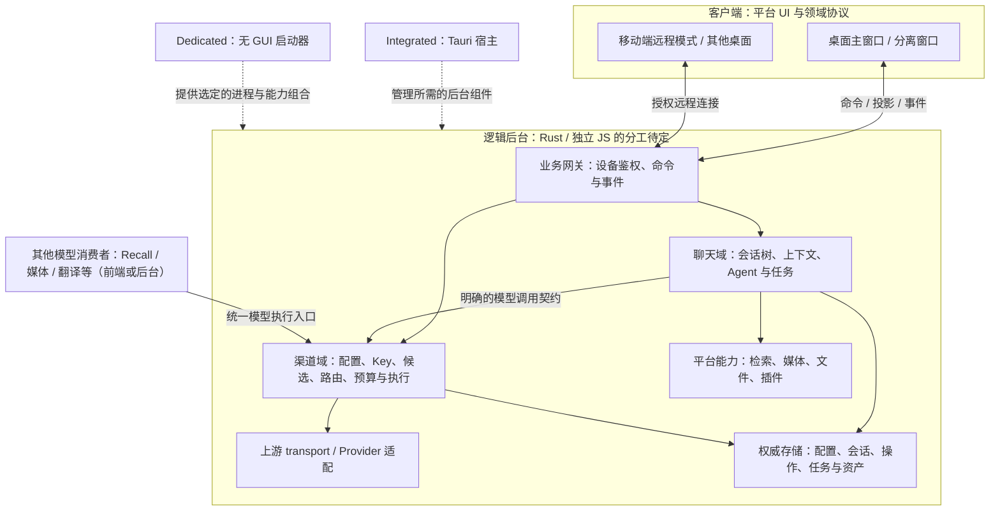

# LLM Chat 与渠道管理 C/S 架构及独立运行时设计（Bun 候选）

> **状态**：架构设计草案；2026-11-02 对照源码核对并纳入渠道管理迁移。已明确聊天与渠道管理的业务运行脱离前端 WebView，Rust / 独立 JS 运行时的职责分配待定。包名、接口与协议示例属于待实现设计。
> **关联文档**：
> - [LLM Chat 当前架构](../../src/tools/llm-chat/ARCHITECTURE.md)
> - [WebView2 瓶颈与引擎迁移调查](./地基迁移调查/webview2-migration-investigation.md)
> - [移动端作为桌面 Companion 的连接构想](./mobile-desktop-companion-connection-concept.md)
> - [移动端与桌面端互通方式调查](./mobile-desktop-interoperability-research.md)
> - [虚拟渠道与模型执行边界](../Plan/llm-virtual-channel-investigation.md)
> - [LLM API 当前架构](../architecture/llm-apis-architecture.md)
> - [模型执行路由契约](../architecture/llm-execution-routing.md)

---

## 1. 目标与现状

目标是将聊天与渠道管理的权威状态和执行生命周期迁出前端 WebView。会话树、上下文编译、Agent 任务，以及渠道配置、Key 管理、模型路由和请求执行由后台运行；桌面与移动客户端负责配置编辑、提交命令和订阅投影。

这里的 Server 指逻辑后台，可由 Rust 与独立 JS 运行时协作实现。先确定领域职责、数据所有权和调用契约，再决定各模块的语言、进程及部署方式。Bun 是独立 JS 运行时的候选；后文的 Bun sidecar 描述用于评估该候选的实施条件。

### 1.1 源码核对结论

| 当前事实 | 对设计的影响 |
| :--- | :--- |
| `llm-chat` 的编排、状态与交互服务仍主要位于 WebView；部分网络、存储与计算能力由 Rust 承担。 | 需要迁出任务所有权及其依赖，单独更换网络请求实现无法达到后台运行目标。 |
| `core/pipeline/defaultProcessors.ts` 当前注册 11 个顶层处理器；`contextPipelineStore` 按启用状态与 `priority` 排序，且支持用户调整顺序。 | “11 级”只描述当前默认注册规模，执行顺序与步骤数量应以配置为准。 |
| 处理器仍引用聊天设置、异步任务 Pinia store、转写 composable、图片/PDF 工具与 UI 错误处理器。 | 运行环境抽象是迁移主体工作，现有目录无法直接整体搬入 Bun。 |
| 当前检索处理器是 `recall-processor.ts`，通过 `src/tools/recall/services/api.ts` 访问思绪集；该门面仍依赖 Pinia 与 Tauri。 | 迁移应围绕现有检索服务契约，保留检索策略与缓存语义。 |
| `ChatStreamReceiver` 已处理 UTF-16 offset、请求起始标识和快照对账。 | 可以复用客户端对账算法；网络游标、鉴权、版本检查与重放日志需要新增。 |
| `llm_proxy.rs` 被共享的 `src/llm-apis/common.ts` 调用；`llm_inspector` 有独立的代理服务入口。 | 渠道与共享请求层迁移时统一评估网络实现，逐项交接消费者和抓包能力；旧代理的去留随该迁移确定。 |
| 渠道配置与 Key 状态分别由 `useLlmProfiles.ts`、`useLlmKeyManager.ts` 管理；`useLlmRequest.ts`、`llmChannelExecution.ts` 将前端状态接到共享核心。 | 渠道管理纳入后台迁移，覆盖权威配置、Key 状态、候选与预算及执行记录；配置 UI 保留为客户端。 |
| 现有共享包包含 `@aiohub/llm-core`、`@aiohub/agent-preset-core` 等；当前尚无 `packages/chat-server`。 | 优先扩展共享核心；本文的 `ChatBackend`、`BunRuntimeManager`、`ServerHostBridge` 与 `ChatTaskRunner` 均为拟新增抽象。 |

### 1.2 借鉴 Minecraft 的架构关系

本文借用 Integrated Server / Dedicated Server / Logical Client 三种角色，表达“本机与远端共用业务服务契约”。这一类比只约束权威状态与客户端的关系。

- **桌面本机模式**：Tauri 宿主提供逻辑后台，并按选定方案启动所需的独立 JS 运行时；主窗口和分离窗口连接同一份权威服务。
- **远端模式**：客户端连接已配对的服务器。会话、任务与上游渠道凭据归服务器，客户端保存视图缓存、草稿和阅读位置。本机正在运行的任务按原服务策略继续执行。
- **内容转移**：跨服务器搬运会话或 Agent 时，走显式导入/导出与资产打包。

单一权威写入者可省去双端离线副本的合并流程，但多个客户端提交互相冲突的命令时，仍需服务端串行化、版本校验与冲突反馈。复杂树可以设计合并算法；本方案选择以在线权威服务控制一致性成本。

### 1.3 窗口生命周期边界

[WebView2 调查第 2.6 节](./地基迁移调查/webview2-migration-investigation.md#26-后台-js-运行时与渲染窗口生命周期耦合)已记录任务与渲染窗口绑定的问题。应分别处理：

- **隐藏窗口**：WebView 仍存在；当前托盘代码有隐藏窗口的路径，隐藏本身无法保证释放渲染内存。
- **销毁或刷新 WebView**：目标架构下，独立服务继续执行任务，重开的客户端重新订阅。
- **退出 Tauri 宿主**：Integrated Server 随宿主退出；需要脱离桌面应用持续在线时，使用 Dedicated Server。
- **后台组件崩溃或重启**：依靠持久化恢复可见状态；执行中的上游请求和工具调用需要单独的中断与恢复策略。若拆成 Rust / JS 多进程，还需按任务依赖判断受影响范围。

---

## 2. 业务边界与运行时分工

### 2.1 已明确的业务职责

- **聊天域**：会话树、上下文与宏、Agent/工具循环、压缩及自动命名；向渠道服务提交明确的模型绑定、operation、参数和任务上下文。
- **渠道域**：渠道与模型配置的权威管理、凭据和 Key 状态、虚拟渠道解析、候选选择、模型执行路由、执行预算、上游请求与实际执行记录。作为所有模型消费者共用的服务，独立于聊天域。
- **客户端**：配置表单、模型选择、输入与展示、草稿和阅读状态；通过授权接口更新后台配置或发起调用。关闭配置页或聊天窗口后，已接受请求及 Key 状态维护继续归后台。
- **平台能力**：文件、系统、原生插件、检索与媒体处理按能力契约接入。每个契约明确数据归属、取消和错误语义。

这些职责在逻辑上分层，实施时可先部署在同一个后台进程。语言与进程边界按依赖和收益确定，避免为了分层让每次流式增量跨越多次 RPC。

### 2.2 Rust / JS 分工待定表

| 能力 | 业务约束 | 选型时需核对 |
| :--- | :--- | :--- |
| 会话树、上下文管道、宏与 Agent 编排 | 执行与权威状态脱离 WebView，保持现有领域行为 | TS 复用成本、运行时依赖、Rust 实现收益及跨语言调用粒度 |
| 渠道配置、模型元数据与虚拟组合 | 单一权威写入口，配置更新有版本，遵守现有元数据固化规则 | 配置 schema 复用、持久化适配、桌面/无头共享范围 |
| 凭据与 Key 状态 | 凭据按权限访问，轮询、健康状态与恢复归后台 | 系统安全存储、Rust/JS 可访问范围，以及是否采用持有 Key 并代发请求的接口 |
| 候选、模型路由与执行预算 | 统一遵守渠道契约，实际执行信息可追溯 | 共享核心复用、跨进程取消、一次逻辑请求的预算归属 |
| 上游 transport 与协议适配 | 保留网络策略、流式语义、媒体请求和错误分类 | 现有 Rust 网络实现与 JS Provider Core 如何组合，数据复制和 Inspector 接入成本 |
| 网关、设备鉴权与事件流 | 共用版本、身份与权限边界 | Rust / JS 承载位置、TLS、连接管理与维护成本 |
| 持久化与任务记录 | 明确提交和恢复边界，每份数据只有一个权威 owner | Rust 或 JS 的存储实现、事务/日志方案、升级与回退 |
| 原生检索、媒体和插件能力 | 保留领域服务契约与能力协商 | 沿用现有 Rust 模块、抽独立 worker 或补充 JS 实现的成本 |

表中各项均保留运行时选择空间。例如，TS 聊天编排可以调用 Rust 承载的渠道执行服务，也可以与 JS 渠道服务同进程运行并复用 Rust transport；选择依据应写入后续实施决策。

### 2.3 Bun 候选的适用性与前提

Bun 能够执行 TypeScript，并提供 HTTP、WebSocket、流式请求与 SQLite 能力，有利于复用现有 TS 领域逻辑。实际迁移仍需处理依赖图、路径别名、配置存储、媒体处理和平台服务。

| 关注点 | 候选用途与实施条件 |
| :--- | :--- |
| TS 复用 | 复用算法和 DTO，拆除 Vue、DOM、Tauri 与 UI 错误提示的传递依赖。现有共享包优先沿用。 |
| HTTP / SSE / WS | 若网关落在 JS，可用 `Bun.serve`；认证、背压、心跳与重连仍由应用协议定义。 |
| SQLite | 若存储落在 JS，可评估 `bun:sqlite`；存储载体与 schema 在持久化决策中确定。 |
| 网络请求 | 对照现有 Rust transport 评估 Bun fetch 的 TLS、代理、HTTP/1.1、超时、取消、multipart、错误分类和抓包兼容性。按最终锁定的 Bun 版本验证。 |
| 运行时分发 | 需要平台/架构产物、打包配置、许可证与更新流程。包管理器使用的 Bun 与随应用分发的运行时分别记录版本。 |

聊天迁移与渠道迁移共同决定旧代理的收敛范围。迁移期间按消费者逐项切换，保留其仍在使用的路径；最终可以保留、整合或替换现有 Rust 网络实现。

### 2.4 Integrated 与 Dedicated 的能力组合

- **Integrated Server**：桌面宿主内的 Rust 服务与可选 JS sidecar 共同提供后台能力。持久化根目录由宿主按项目应用路径规则解析并交给相应存储 owner。
- **Dedicated Server**：使用显式配置的数据根目录。若后台依赖 Rust 与 JS 两部分，则需要同时提供脱离 GUI 的运行形态；尚未适配的能力在协商中标记为不可用。
- **移动端本机模式**：保留现有移动后端适配；后续是否共用新的 Rust 核心随分工确定。移动端连接远端时使用 `RemoteServerBackend`，Bun 的分发范围另行评估。

两种服务部署形态共享领域契约，具体进程组合与能力集合按部署声明。`packages/chat-server` 仅作为聊天服务拆包示例；渠道服务是跨工具基础设施，包布局与服务入口随职责分工确定。

## 3. 总体逻辑架构

下图表达领域调用关系，框内模块由 Rust 或独立 JS 运行时承载的具体方案待定。




客户端业务网关、后台领域调用与平台特权接口分别定义权限和调用范围。Rust / JS 同进程可直接调用，跨进程才引入受认证的内部协议；其位置与拓扑由后续分工决定。

---

## 4. 模块剥离、数据所有权与命令契约

### 4.1 迁移矩阵

下表路径相对 `src/tools/llm-chat/`。Server 表示后台领域归属，具体 Rust / JS 落点按第 2.2 节确定。

| 当前源码 | 目标归属 | 已确认的耦合与迁移工作 |
| :--- | :--- | :--- |
| `core/pipeline/*`、`core/context-processors/*` | Server | `PipelineEngine` 经 `@/utils/errorHandler` 引入 Vue / Element Plus；正则、异步任务、转写和资产处理分别依赖设置、Pinia、composable、图片/PDF 能力。需拆分领域数据与平台适配器。 |
| `macro-engine/*`、`core/context-utils/macro.ts` | Server | 保留解析、注册与求值逻辑；`system` 宏依赖 Tauri OS/app API，`tools` 宏依赖工具发现服务。系统信息、工具清单、资产元数据和求值时间均通过显式上下文提供。 |
| `services/sessionPersistenceRepository.ts`、`sessionPersistenceCoordinator.ts` | Server | 替换 Tauri FS/path，保留现有备份回退、损坏隔离、修订号和写入协调语义。选定存储实现后还需定义文件替换、刷盘与崩溃恢复边界。 |
| `services/requestSnapshot*.ts`、`core/context-utils/preview-builder.ts` | Server | 上下文分析器经查询接口取得预览投影；预览绑定会话与配置版本，并约束宏变量、任务和检索缓存等副作用。 |
| `composables/session/useNodeManager.ts`、`useBranchManager.ts`、`useSessionNodeHistory.ts` | Server 领域逻辑 + Client 导航状态 | 抽离树操作与历史；50 步历史上限来自 `useSessionNodeHistory`。多客户端 Undo/Redo 需要校验目标版本和生成中的节点。 |
| `composables/chat/useChatExecutor.ts`、`useSingleNodeExecutor.ts`、`services/llmChatService.ts` | Server 编排 + Client 输入适配 | 服务端持有请求、取消、压缩、自动命名、Sub-Agent 和工具循环；输入框读取、提示与草稿组装留在客户端。 |
| `services/chatStreamReceiver.ts` | Client，可抽成共享核心 | 复用 offset 拼接与快照对账；外层增加实例、任务/生成标识、快照版本和订阅生命周期校验。 |
| `components/*`、`composables/visualization/*`、`composables/input/*` | Client | 保留渲染、输入、布局与平台交互。附件元数据/预处理可在客户端形成，权威资产注册与上游请求编译由服务端完成。 |

### 4.2 渠道管理迁移范围

下列源码路径相对仓库根目录。迁移覆盖配置与实际执行链路，配置编辑界面继续作为客户端保留。

| 当前入口 | 后台迁移职责 | 客户端与调用边界 |
| :--- | :--- | :--- |
| `src/composables/useLlmProfiles.ts`、`src/types/llm-profiles.ts` | 渠道/模型/虚拟组合的权威配置、版本、导入导出与引用维护 | 表单读取配置投影，经命令更新；模型元数据在创建、导入、刷新或显式应用预设时固化，执行端读取模型已保存值。 |
| `src/composables/useLlmKeyManager.ts` 及凭据存取适配 | Key 选择、健康状态、冷却/恢复与持久化，凭据按授权交给实际请求执行者 | 常规界面接收掩码与状态，凭据维护使用独立授权接口；Rust / JS 间是否传递 Key 随执行边界确定。 |
| `src/composables/llmChannelExecution.ts`、`packages/llm-core/src/virtual-channel.ts` | 虚拟候选、回放目标、预算、取消、输出后成员固定与尝试记录 | 聊天、Recall、媒体等提交逻辑绑定与用途；各 operation 的支持范围按现有契约逐项迁移。 |
| `src/composables/useLlmRequest.ts`、`packages/llm-core`、`src/llm-apis/` | 模型路由、Provider 参数构建、请求/响应与流解析、错误分类 | 共享核心是复用起点；前端 facade 改为后台调用适配，Rust / JS 之间选择合适的整轮请求边界。 |
| `src/llm-apis/common.ts`、Rust LLM proxy 与 Inspector 接入 | 网络策略、上游连接、取消及诊断采集 | 业务消费者使用统一执行入口，Inspector 接收按权限脱敏的执行记录。旧路径按消费者迁移进度交接。 |

渠道域为每次逻辑请求关联绑定、配置版本、任务来源、取消标识和执行预算，输出规范化增量、结果、错误及实际执行信息。具体 DTO 优先沿用共享核心；进程拆分时补充流式协议和取消确认，避免两端分别管理候选或重复累计预算。

客户端可按 `ChatBackend` 与渠道配置/执行接口分开组织代码，但它们共用后端连接、服务身份、授权与事件基础设施。后台的聊天编排通过渠道领域端口调用，具体为同进程函数或跨进程请求由部署决定。

### 4.3 自包含命令与执行上下文

当前 `llmChatService.sendMessage` 在参数缺失时读取当前会话、当前 Agent 和输入框临时模型。目标服务入口改为显式命令。以下为领域草案，引用类型沿用仓库，新增类型的最终位置在拆包时确定：

```ts
export interface SendChatTurnCommand {
  operationId: string;
  sessionId: string; // 首期发送要求会话已创建
  parentId: string; // 必须是该会话中存在且允许追加的父节点
  expectedSessionVersion: number;
  agentId: string;
  modelSelection:
    | { kind: "agent-binding" }
    | { kind: "explicit"; model: ModelIdentifier };
  content: string;
  attachmentIds?: string[]; // 当前 Server 已注册且调用者有权使用的资产
  disableMacroParsing?: boolean;
}
```

- 创建会话使用独立的幂等命令，并明确根节点初始化规则；发送命令校验 Agent、父节点和资产归属。
- 聊天服务固定本轮 Agent 与上下文配置版本，并把明确的模型绑定和调用上下文交给渠道服务。渠道服务负责校验绑定并固定本轮渠道执行配置快照，统一管理候选、替换、回退和重试预算；实际目标与尝试记录关联聊天任务。
- Sub-Agent 深度、工具权限与成本限制由服务端执行上下文推导；客户端提供的字段只能作为经校验的请求参数。
- 成功接受后返回 `operationId`、`taskId` 和会话版本；失败返回可分类错误，由各端 UI 决定提示方式。

### 4.4 并发写入与幂等

1. **单写入者**：同一业务数据集只有一个权威 owner。后台按领域分配 Rust / JS 存储职责，多进程共用根目录时隔离写入文件和数据库。切换时停止旧 owner 的自动保存并完成待写数据；旧 WebView 与新服务同时写相同 JSON 会绕过网络版本校验。
2. **配置与聊天分别交接**：渠道配置、Key 状态归渠道域 owner；会话树归聊天域 owner。Agent、世界书和资产管理的独立编辑入口也需通过对应后台更新。跨域使用带版本投影和变更事件，各域保持自己的写入责任。
3. **同一会话命令串行提交**：树变更与任务提交校验 `expectedSessionVersion`。多个生成任务可并行请求上游，但节点提交仍进入会话写入队列；编辑、删除、压缩和 Undo 遇到运行中的依赖节点时，明确拒绝或先取消并等待终态。
4. **版本分工**：新增逻辑 `sessionVersion` 标识内存中的领域提交；现有 `_persistence.revision` 继续标识持久化提交。流式增量另由 `generationId + offset` 定位，两类版本在快照中明确标注。
5. **持久化去重**：以服务器、调用设备与 `operationId` 定位操作，保存请求摘要和原始回执；同 ID、不同正文返回冲突。去重记录、会话节点与任务记录定义统一的提交/恢复边界，接受回执在可恢复提交后返回。沿用多文件 JSON 时需引入可恢复操作日志；若改用事务存储，另写格式迁移方案。
6. **上游结果不确定性**：服务在上游已接受请求、但本地尚未记录结果时崩溃，无法仅凭客户端 operationId 保证上游恰好执行一次。恢复时将此类任务标记中断或结果待确认，自动重发依赖上游幂等能力和任务策略。

### 4.5 共享树与客户端阅读状态

节点、拓扑、压缩结果和任务状态由 Server 持有。阅读位置、展开状态、草稿与当前查看分支按客户端保存。现有 `activeLeafId` 可以保留为存档默认分支；显式变更该默认值属于带版本的共享写操作。单纯查看另一分支应只更新客户端阅读状态，发送时仍显式提交 `parentId`。

---

## 5. 客户端 `ChatBackend` 与数据隔离

桌面和移动端已有各自 UI 与平台存储。优先共享 DTO、协议和可脱离 UI 的逻辑，各端通过适配层使用已有界面。

### 5.1 接口草案

```ts
export interface ChatBackend {
  readonly backendId: string; // 客户端配置 ID；连接后核验稳定 serverId
  readonly kind: "standalone-local" | "integrated-local" | "remote-server";

  listSessions(query?: SessionListQuery): Promise<SessionsIndexProjection>;
  getSessionSnapshot(sessionId: string): Promise<SessionSnapshotEnvelope>;
  createSession(cmd: CreateSessionCommand): Promise<SessionCreatedReceipt>;
  sendChatTurn(cmd: SendChatTurnCommand): Promise<TurnAcceptedReceipt>;
  cancelTask(cmd: CancelTaskCommand): Promise<TaskReceipt>;
  mutateTree(cmd: TreeMutationCommand): Promise<TreeMutationResult>;
  buildContextPreview(query: ContextPreviewQuery): Promise<ContextPreviewData>;
  getAssetAccess(assetId: string): Promise<AssetAccessDescriptor>;
  uploadAsset(file: Blob, meta: AssetUploadMeta): Promise<AssetProjection>;
  subscribe(options: SubscriptionOptions, handler: (event: ServerEvent) => void): UnsubscribeFn;
}
```

示例聚焦聊天业务；渠道配置与统一模型执行是独立的共享后台能力，Agent、世界书、任务列表和操作状态查询也需配套接口。连接状态通过事件或各端响应式适配器呈现，协议层保持普通 TS 类型。取消操作明确指向 `taskId` / `generationId`，携带操作 ID；树变更命令同样携带预期版本。

### 5.2 模式与切换规则

| 维度 | 桌面本机内置服务 | 远端服务 | 移动本机后端 |
| :--- | :--- | :--- | :--- |
| 连接 | Tauri 提供本次就绪的回环地址与本机客户端凭据 | 配对后解析候选 Endpoint，验证服务身份 | 现有移动运行时适配 |
| 权威数据 | 本机应用配置目录；由服务独占相应业务写入 | 远端服务数据根目录 | 移动端自己的存档与存储格式 |
| 客户端缓存 | 视图、草稿、阅读状态 | 按服务和设备身份隔离的投影缓存、草稿、阅读状态 | 沿用本机存储，缓存层可共用领域接口 |
| 资产 | 经授权的本地协议或回环流 | 受控资产接口；返回客户端可访问的地址/句柄 | 沿用移动资产注册与解析 |
| 离线 | 服务不可用时显示缓存和可行动错误 | 已接受任务由远端继续执行；草稿留在客户端 | 按移动平台现有能力执行 |

缓存键至少包含稳定 `serverId`、当前授权身份与业务 ID，避免跨主机 ID 碰撞或切换设备凭据后泄漏旧投影。服务器重启只更换运行实例 ID；安装/存档迁移时如何保留 `serverId` 需随存储规范确定。

切换后端时取消旧订阅、清空 receiver 暂存与内存投影、替换资产解析器，并隔离未完成请求的回调。旧服务上已接受的任务继续归旧服务，界面保留任务入口；跨服务发送草稿前须重新上传或注册附件。远端断线期间仅保留草稿，写命令在重连后重新校验版本。

---

## 6. 流式事件、快照与断线重连

### 6.1 现有 receiver 的复用范围

`ChatStreamReceiver.receive()` 用绝对 UTF-16 offset 去重和补齐文本；节点缺失或出现缺口时请求快照。`snapshot()` 按 `requestStartTime` 对齐同轮请求并重放暂存增量。当前类没有服务身份校验、网络事件序号、过期快照拒绝或跨重启的任务恢复能力。

网络适配层应先校验 Server / 实例 / 会话版本，再将合法 payload 交给 receiver。以明确的 `generationId` 识别请求轮次，逐步替代仅依赖可选时间戳的识别方式。

### 6.2 事件与版本

- **事件信封**：携带 `protocolVersion`、`serverId`、`instanceId`、`seq`、事件类型及相关会话/任务 ID。cursor 编码实例和事件位置；授权过滤允许产生序号空隙。
- **`stream.delta`**：包含现有增量字段，并关联 `taskId` / `generationId`；正文与 reasoning 分别计算 offset。
- **`session.snapshot`**：包含领域版本、持久化修订号、运行任务投影及一致的事件水位。终态快照结束对应生成；较旧快照在 receiver 外层拒绝。
- **`task.state`**：覆盖排队、执行、审批等待、中断及终态。后台任务 registry 可复用投影思路，执行恢复由任务运行器负责。
- **`cursor.expired` / reset**：表示需要重新取得订阅范围的权威投影。范围包括会话列表、打开的会话、任务和已订阅配置，避免只恢复当前一条会话。

事件缓冲同时按条数、字节与保留时间设上限。大快照走独立查询；慢客户端限流或断开后重建投影，避免其阻塞任务或无限占用服务内存。重放前按当前权限重新过滤，撤销授权时终止既有订阅。

### 6.3 快照与订阅的衔接

1. 客户端携带上次 cursor 请求续订；窗口内的事件按顺序重放。
2. cursor 过期或服务实例变化时，通过服务端提供的“一致快照 + 水位”流程重建：在串行提交边界捕获投影与 cursor，再从该水位后补发事件。传输期间缓冲过期则重新开始。
3. 快照之后到达的旧事件根据水位丢弃；新事件经过版本与 generation 校验后应用。receiver 的 offset 对账仅负责单轮文本范围。
4. WebView 刷新或手机断线与任务取消解耦；后台执行组件重启后，受影响的非终态任务默认显示中断，具备专门恢复能力的任务再按策略恢复。渠道执行与聊天编排分进程时，还需对齐取消、失败和终态确认。

浏览器原生 `EventSource` 无法任意设置 Authorization Header；拟采用 fetch 流读取 SSE，显式发送凭据与重连游标。若选 WebSocket，需设计适配客户端 API 的握手票据/认证过程。完整协议随实现确定，两种传输共用领域事件。

---

## 7. 宿主、进程协作与分发

以下进程管理描述针对选用 Bun sidecar 的候选方案。网关、渠道、存储及聊天模块在 Rust / JS 间的最终位置确定后，再落实具体桥接方法和启动入口。

### 7.1 Bun sidecar 候选的生命周期

- **启动与就绪**：实际承载 HTTP 服务的组件绑定 `127.0.0.1:0`，向宿主回报端口、协议版本、实例 ID 与能力。若该组件位于 Bun，则经受控父子通道回报，Rust 校验就绪与超时。跨进程领域调用及平台接口另行握手。
- **凭据分域**：本机客户端 token 与内部原生桥 token 分开生成，使用安全随机数；经受限 IPC/父子通道传递，日志与可见命令行参数中清除秘密。仅将客户端所需凭据交给被授权窗口。
- **Windows**：Job Object 使用 `JOB_OBJECT_LIMIT_KILL_ON_JOB_CLOSE`，宿主持有 Job 句柄且禁止子进程继承；优先挂入 Job 后再放行子进程执行。加入失败应终止启动。该机制在最后一个 Job 句柄关闭时终止关联进程，实际完成时间由系统调度决定。
- **Linux**：可使用 `PR_SET_PDEATHSIG`，处理父进程退出竞争及父线程语义，并结合父子管道/进程组管理后代。
- **macOS**：使用父子管道 EOF、平台进程监控与进程组退出策略；`prctl(PR_SET_PDEATHSIG)` 属于 Linux API。
- **正常退出与崩溃**：先停止接受新命令，按任务策略取消/等待并完成可恢复写入，再退出 Bun；超时才强制结束。Bun 异常退出时向客户端暴露可行动状态，重启后换新实例并恢复可见任务记录。

关闭窗口与保留托盘、销毁 WebView 的具体策略需在真实 Tauri 环境验证。服务与渲染进程分离后仍需测量内存、启动耗时和大上下文负载，本文不预设内存收益数值。

### 7.2 领域调用与平台能力接口

按最终分工定义必要的 Rust / JS 内部调用。Bun 无法直接调用 WebView 的 `invoke`；需要 Rust 能力时，经受认证的内部接口访问。同进程领域调用沿用普通接口，跨进程接口明确方法范围、数据大小、超时、取消和并发上限。

- **渠道执行**：若聊天与渠道位于不同进程，以整轮逻辑模型调用为边界，统一任务标识、预算和流式结果。凭据持有者、上游连接持有者与重试 owner 显式约定；避免把整个渠道对象和 Key 无差别传给每个消费者。

- **检索**：抽出 `recall` 服务契约，保留当前查询编译、检索策略、向量配置、缓存隔离和资产代际语义；底层按需要调用 Rust `recall` / `knowledge` 能力。
- **媒体与系统能力**：图片/PDF、OCR、目录搜索、去重与原生插件等分别适配。依赖 WebView 的服务还需单独迁移；关闭窗口后继续执行的任务只能依赖独立运行的能力。
- **客户端工具**：经用户批准后，设备可声明自己提供的工具；路由绑定设备、工具版本与调用权限。设备离线、审批超时或撤销授权时，返回明确状态，避免自动转由另一主机执行。
- **审批与协议**：高危操作的授权由执行端落实；沿用 [tool-calling](../../src/tools/tool-calling/ARCHITECTURE.md) 和 [vcp-connector](../../src/tools/vcp-connector/ARCHITECTURE.md) 已定义的协议与授权流程。

### 7.3 打包与更新

先确定 Rust / JS 模块落点与进程组合，再选择 JS bundle、Bun sidecar 或独立可执行文件的分发方式，并维护资源配置、签名、许可和更新策略。各后台组件、宿主、服务协议及持久化 schema 需要兼容协商；更新前协调各域 owner 停止写入，必要时备份。开发与发布产物均使用明确入口。

---

## 8. 网关与远程安全边界

### 8.1 默认本机服务

默认仅绑定 `127.0.0.1`，仍要求客户端 token、Host/Origin 检查、严格 CORS 与 WebSocket Origin 校验。回环地址限制网络监听范围，本机恶意网页、DNS rebinding 或被盗 token 的风险仍需由认证和请求校验处理。

原生桥与业务服务使用独立凭据和方法范围。Tauri 窗口授权、WebView 网络策略和原生移动网络限制随接入配置核对。

### 8.2 用户开启远程连接

1. **网络与身份**：支持局域网、用户配置的 VPN/隧道；保持 Companion 构想中的官方中继边界。远程 API 使用经身份校验的 TLS，或经明确设计和验证的加密通道。VPN 可达性与设备授权分别检查。
2. **配对**：一次性二维码包含服务器标识、候选 Endpoint、公钥/证书指纹、短期 nonce 和有效期。握手验证持钥证明与防重放，授权端明确确认设备及 scope 后签发可撤销凭据。具体密码学协议与证书信任流程需单独确定。
3. **授权**：沿用 Companion 的 `chat:read`、`chat:write`、`assets:read`、`assets:upload`、`tools:execute` 等 scope，并检查具体会话、任务与资产访问权。渠道配置维护、凭据维护与模型执行另行细分权限；聊天权限仅授权其业务范围内的调用。吊销同时终止订阅、客户端工具挂载和未完成审批。
4. **凭据与投影**：上游 API Key 留在服务器，由模型执行层使用。模型列表、Agent、快照、请求分析和错误信息均返回按权限裁剪的投影；原始 Authorization Header、插件秘密与本地绝对路径需脱敏。
5. **资产**：使用可鉴权的流读取、同源会话或短期单资产签名地址；长期设备 token 留在凭据通道。接口校验资产归属、路径、媒体类型、大小和 Range 请求，渲染环境处理返回内容的执行风险。
6. **高危动作**：文件写删、Shell、浏览器自动化和高成本调用按执行端策略审批；无头部署提供自己的审批渠道或保持拒绝。UI 离线时审批保持等待或超时。

路由建议在协议设计时统一选定版本化前缀；现有内部 LLM proxy 的回环与 capability 边界继续保留，远端客户端使用专用业务 Gateway。

---

## 9. 渐进实施路线与待定项

以下阶段描述依赖顺序，具体施工计划进入 `docs/Plan/` 后维护。

### Phase 1：领域契约与最小后台闭环

- 结合聊天、渠道、共享核心与现有 Rust 能力的依赖图，确定首期模块落点、进程组合和配置/凭据/存储 owner，并记录选择依据。
- 抽出聊天、渠道执行、检索、媒体、工具、日志和存储端口；优先迁移可复用 TS 逻辑，Rust 部分按明确职责实现或复用。包布局据此确定。
- 打通“客户端命令 → 聊天编排 → 渠道执行 → 结果与持久化”的纯文本闭环；渠道执行同时保留供其他模型消费者接入的接口。
- 定义版本、操作/任务记录和 owner 交接，沿用相关领域行为测试。

### Phase 2：桌面后台与消费者迁移

- 落实宿主和所需 sidecar 的启动、内部调用与本机客户端鉴权，接入后台客户端适配。
- 迁移渠道配置、Key 状态、请求执行及诊断，再按 operation 和消费者交接现有调用入口；聊天、Recall、媒体等共用迁移后的渠道能力。
- 处理 Agent、世界书和资产编辑入口的写入交接。旧 proxy 随实际 transport 方案逐步整合或替换，调用方全部切换后再清理旧路径。
- 在真实 Tauri 窗口核对刷新/销毁后的执行存活、配置一致性与重连恢复。

### Phase 3：远端网关与设备授权

- 固化事件信封、快照水位、配对/TLS、聊天与渠道权限、资产访问和高危动作审批策略。
- 提供连接管理、授权设备、吊销入口，以及按最终 Rust / JS 依赖交付的 Dedicated 形态。

### Phase 4：移动端与跨桌面连接

- 各端增加远程聊天与渠道接口的适配及后端切换，保留移动本机实现；可共享的后台模块按平台支持接入。
- 落地按服务器/授权身份隔离的缓存、离线草稿、资产重注册和旧连接回调隔离。
- 使用多个客户端核对会话并发、渠道配置变更、任务与 Key 状态投影，以及移动切后台后的恢复。


### 实施前需确定

- 聊天、渠道、网关、上游 transport 与存储各模块的 Rust / JS 落点、调用粒度及进程组合。
- 渠道凭据与 Key 状态的 owner、密钥访问范围、配置版本和后台执行接口。
- Dedicated 首期的能力集合，以及所需 Rust 服务/worker 与 JS 运行时的无 GUI 分发方式。
- 继续使用 JSON + 操作日志，或另行迁移事务存储；两者对应的恢复与回退格式。
- 配对协议、证书信任、WebView/移动端连接方式及无头审批渠道。
- 预览的副作用规则、运行中节点的编辑约束和多客户端 Undo/Redo 语义。
- 服务分发平台、JS 运行时选型与版本、进程退出策略及后台组件升级兼容范围。

## 参考依据

源码事实以第 1 节和迁移矩阵所列文件为准。外部 API 依据在 2026-11-02 核对：

- [Bun HTTP 服务](https://bun.com/docs/api/http)、[fetch / TLS / proxy](https://bun.com/docs/api/fetch)、[SQLite](https://bun.com/docs/api/sqlite)。
- [Windows Job Objects](https://learn.microsoft.com/en-us/windows/win32/procthread/job-objects)：Kill-on-close 依赖最后一个 Job 句柄关闭。
- [Linux PR_SET_PDEATHSIG](https://man7.org/linux/man-pages/man2/PR_SET_PDEATHSIG.2const.html)：Linux 专有接口，含父线程与退出竞争语义。
- [MDN EventSource 构造参数](https://developer.mozilla.org/en-US/docs/Web/API/EventSource/EventSource)：原生接口提供 URL 与凭据模式选项，自定义 Header 需采用其他客户端实现。
