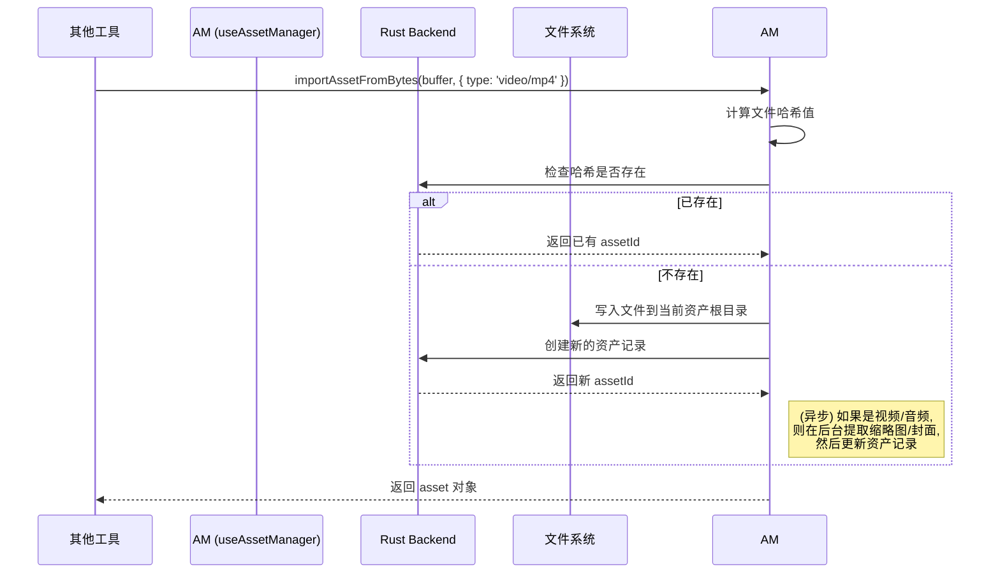

# Asset Manager: 架构与开发者指南

本文档旨在解析 Asset Manager 工具的内部架构、设计理念和数据流，为后续开发提供清晰的指引。

## 1. 核心概念

Asset Manager 是应用的**中央资产管理中心**，提供统一的资产存储、索引、查询和去重功能。

### 1.1. 统一资产管理 (Unified Asset Management)

通过全局单例 `useAssetManager` 管理所有资产，实现跨工具的资产复用。

- **统一存储**: 所有工具的资产都保存到统一的资产根目录。存储根按以下规则解析（见 `get_asset_base_path`，[`src-tauri/src/commands/asset_manager.rs`](../../../src-tauri/src/commands/asset_manager.rs)）：
  1. 优先读取应用设置（`$APPDATA/app-settings/settings.json`）中的 `customAssetPath`；该字段存在且非空时，直接以其作为资产根，目录不存在会自动创建。
  2. 未配置或字段为空时，回退到应用数据根下的 `$APPDATA/assets/` 目录。
  - 资产根目录切换后，索引与文件都跟随新的根目录，旧根目录中的既有资产不会自动迁移。
  - 前端可在「设置 → 通用 → 资产存储」中修改该路径（见 [`src/views/Settings/general/AssetSettings.vue`](../../views/Settings/general/AssetSettings.vue)）。
- **索引相对位置**: 中央索引固定位于资产根下的 `.catalog/assets.jsonl`（即 `$ASSET_ROOT/.catalog/assets.jsonl`），随资产根一同切换。
- **自动去重**: 基于文件哈希值进行重复文件检测，相同文件只存储一次。
- **来源追踪**: 记录每个资产的来源模块（如 `llm-chat`）和来源类型（如 `local`, `clipboard`, `generated`）。
- **多媒体元数据提取**:
  - **视频缩略图**: 自动截取视频文件的第一帧作为预览图。
  - **音频封面**: 利用 `lofty` 库从音频文件（如 MP3, FLAC）中提取内嵌的专辑封面。
  - **音频波形采样**: 利用前端 Web Audio API (OfflineAudioContext) 在浏览器端离线解码音频文件，提取低分辨率波形采样数据（100 个 0-255 的整数点），持久化到资产元数据中。详见 [`src/utils/audioSampler.ts`](../../utils/audioSampler.ts)。

### 1.2. 存储根与索引布局 (Storage Root & Index Layout)

资产管理器通过 Rust 命令 `get_asset_base_path` 统一解析资产根目录，前端不自行拼接固定的 `$APPDATA/assets/` 路径：

- 如果应用设置中的 `customAssetPath` 存在且非空，则优先使用该路径作为资产根，并在需要时创建目录。
- 如果未配置有效的 `customAssetPath`，则使用应用数据根下的 `assets` 目录作为默认资产根。
- 索引文件相对资产根的位置固定为 `.catalog/assets.jsonl`，即 `$ASSET_ROOT/.catalog/assets.jsonl`。导入、查询、去重和重建索引均基于当前解析出的资产根；更改自定义路径不会自动迁移旧根目录中的文件和索引。

### 1.3. Rust 后端索引 (Rust-powered Indexing)

所有查询、筛选和排序操作都通过 Rust 后端执行，以获得高性能。

- **核心优势**:
  - **高性能**: 通过读取资产根下 `.catalog/assets.jsonl` 索引文件到内存中进行快速筛选和排序。
  - **准确性**: 直接操作文件系统元数据，保证数据一致性。
- **查询接口**: 前端通过 `invoke` 调用 Rust 命令（如 `list_assets_paginated`）执行查询。

### 1.4. 多维度分组与筛选 (Multi-dimensional Grouping & Filtering)

支持灵活的数据组织方式，便于用户快速定位资产。

- **分组维度**: 支持按 **月份**、**类型**、**来源** 和 **来源模块** 对资产进行分组。
- **筛选条件**: 可按文件类型、来源模块、搜索关键词等进行精确筛选。

## 2. 架构概览

- **State (`useAssetManager`)**: 全局单例 Composable，管理资产列表、统计信息和用户偏好。
- **View (`AssetManager.vue`)**: 负责 UI 渲染，包括网格/列表视图、筛选器和分组器。
- **Engine (Rust Backend)**: 负责实际的文件存储、索引、查询和去重逻辑。
- **DocumentViewer (`src/components/common/DocumentViewer.vue`)**: 负责资产管理器中的文档预览；资产管理器提供资产文件路径、文件名和 MIME 类型提示，不重复实现文档解析与渲染。
- **DocumentConversionSettingsDialog**: 负责承接文档转换设置，并将配置持久化到资产管理器配置；转换程序选择、路径、超时和隔离配置由共享文档查看/转换流程使用。

### 2.1. 文档预览与转换边界

`AssetManager.vue` 通过共享组件 `DocumentViewer` 在预览弹窗中处理文档资产，并通过 `DocumentConversionSettingsDialog` 管理文档转换设置。资产管理器的职责是提供资产上下文和配置入口，文档格式识别、解析、渲染及需要时的本机转换由共享文档查看器与转换服务负责。

当前支持的文档范围包括 Markdown、HTML、PDF、DOCX、WPS、OpenDocument 文本文档（ODT、OTT、FODT）和代码。WPS 按内容识别：可直接复用 DOCX 渲染的 OOXML 内容直接预览，二进制或 RTF 兼容格式通过配置的本机转换程序生成 DOCX 预览；原始资产保持只读，转换副本不替代原文件。OpenDocument 文本文档由共享查看器解析正文、样式、列表、表格和内嵌图片；复杂分页与排版以办公软件中的显示为准，加密或损坏文件显示错误。

## 3. 数据流：导入一个新资产

## 4. 核心逻辑

- **无限滚动**: 使用共享 `useScrollPagination` 处理分页。首屏加载一页，页面激活且用户向下滚动接近底部时追加；请求期间去重，数据耗尽后停止追加。
- **重复文件扫描**: 通过 `find_duplicate_files` 命令扫描所有文件的哈希值，找出重复项并计算可节省的空间。
- **配置持久化**: 用户的视图偏好（如视图模式、分组方式、排序规则）会自动保存，并在下次启动时恢复。

## 5. 未来展望

- **性能优化**: 当前索引机制（读取 `.catalog/assets.jsonl` 到内存）在资产超过10万个时可能遇到瓶颈。未来应考虑将索引迁移到 SQLite 数据库，以提升大规模数据集下的查询性能。
- **视频处理**: 改进视频缩略图的生成速度和效率。

