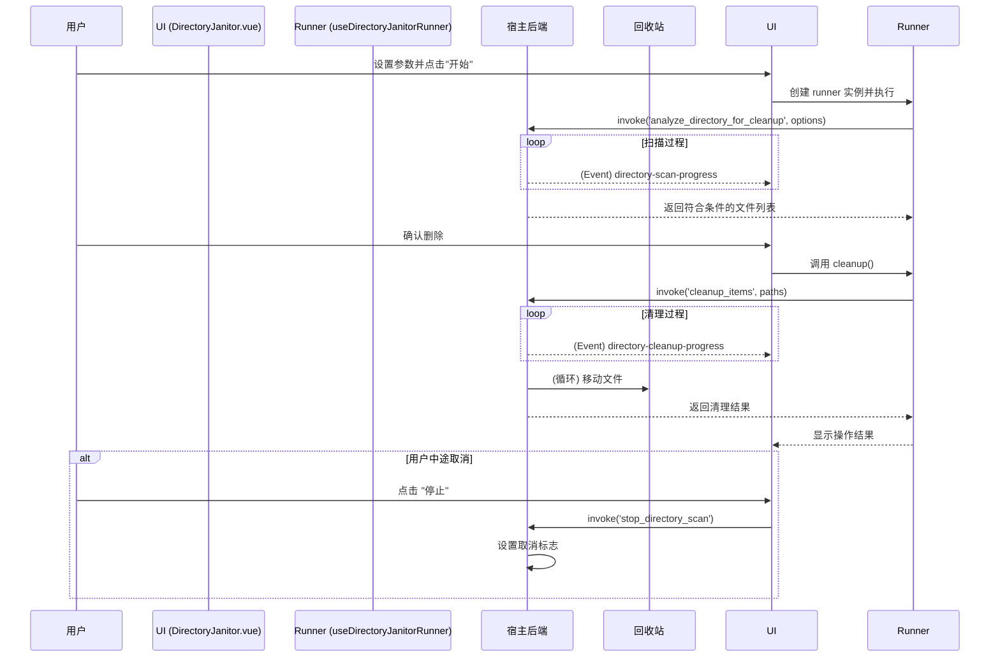

# Directory Janitor: 架构与开发者指南

本文档旨在解析 Directory Janitor 工具的内部架构、设计理念和数据流，为后续开发提供清晰的指引。

## 1. 核心概念

Directory Janitor 是一个目录清理工具，旨在通过高性能后端扫描和灵活的过滤规则，帮助用户安全、高效地管理磁盘空间。

### 1.1. 宿主后端执行

文件系统扫描、筛选和回收站操作在宿主后端执行。Tauri 使用 Rust 模块，Electron 使用 `electron/directory-janitor.ts`；共享前端通过平台门面保持同一命令契约。

- **调用方式**: 前端通过平台门面的 `invoke` 调用 `analyze_directory_for_cleanup` 和 `cleanup_items` 等命令。
- **核心优势**:
  - **响应性**: Electron 使用异步文件系统访问与一次后序尺寸累计，扫描和停止操作保留主进程事件循环响应。
  - **元数据**: 使用宿主文件系统元数据进行年龄、大小和目录深度筛选。
  - **安全性**: 宿主检查路径与目标类型，清理统一使用系统回收站。
  - **可控性**: 后端任务（扫描与清理）支持通过 `stop_directory_scan` 等命令随时取消，并通过窗口事件向前端实时上报进度。

### 1.2. 灵活的过滤规则 (Flexible Filtering Rules)

支持多种过滤条件的任意组合，以适应复杂的清理场景。

- **支持的条件**:
  - **名称模式**: `namePattern` (Glob 格式, 如 `*.tmp`, `*.log`)
  - **文件年龄**: `minAgeDays` (文件最后修改时间距今的天数)
  - **文件大小**: `minSizeMB`
  - **目录深度**: `maxDepth`
- **组合逻辑**: 所有条件在宿主后端以 `AND` 逻辑组合执行。

### 1.3. 安全清理机制 (Safe Cleanup)

为了防止用户误删重要文件，工具采取了安全优先的删除策略。

- **移至回收站**: Tauri 使用 `trash` crate，Electron 使用 `shell.trashItem()`，将选中的文件和目录**移至系统回收站**。
- **用户确认**: 在执行清理操作前，UI 层会明确提示用户将要删除的文件数量和总体积，并要求二次确认。

## 2. 架构概览

- **State/View (`DirectoryJanitor.vue`)**: 负责 UI 渲染、用户输入（目标目录、过滤规则）和结果展示。
- **Registry (`DirectoryJanitorRegistry`)**: 作为对外门面提供无状态的高级 API（`scanDirectory`, `cleanupItems`, `scanAndCleanup`），每次调用都创建临时 Runner 并封装与后端的交互逻辑。
- **Runner (`useDirectoryJanitorRunner`)**: 一个临时的、有状态的 Composable，用于管理单次扫描/清理任务的完整生命周期（初始化、执行、结果格式化、清理）。
- **Engine (宿主后端)**: 负责执行实际的文件系统扫描和清理操作。

## 3. 数据流：执行一次“扫描并清理”

## 4. 核心逻辑

- **预设规则**: 内置了针对常见清理场景（如浏览器缓存、VSCode 历史任务）的预设规则，简化用户操作。
- **无状态门面**: `DirectoryJanitorRegistry` 本身是无状态的，每次操作都会创建一个临时的 `runner` 实例，确保了操作的隔离性和可预测性。

## 5. 未来展望

- **系统文件保护**: 增加扫描黑名单，防止用户意外扫描系统保护目录。
- **符号链接处理**: 优化对符号链接的处理逻辑，避免误删。

## Electron 生命周期与部分完成（2026-11-05）

四个命令由 `electron/main.ts` 显式注册。扫描按窗口持有任务与进度，单个窗口同类扫描并发提示等待；回收站清理在应用内保持一个活动任务。停止命令只取消当前调用窗口的相应任务。文档导航、刷新、渲染进程退出和窗口销毁抑制旧进度并停止后续处理；应用退出等待已进入系统回收站的调用完成。

Electron 扫描以选定目录的真实路径为根，隐藏根条目与后代符号链接跳过；候选目录大小包含真实的隐藏子项和深层文件。清理保留磁盘/共享根目录，验证目标的真实路径与文件身份；链接路径及含链接目录返回单项错误。文件系统权限与路径可能被外部进程改变，校验属于尽力检查，失败保留具体原因。

重复清理路径归一并先处理父目录；父目录成功后，所选子项计入完成路径，空间累计一次。失败条目继续保留，其他选中项独立处理。Electron 返回的 `cleanedPaths` 和 `cancelled` 是 `CleanupResult` 的可选扩展：界面据此移除已清理目录的显示后代，保留尚未处理的条目及勾选，并通过入口禁用与 Runner 重入保护维持在途任务。Tauri 旧结果使用兼容消费路径。

相关宿主测试 22 项、前端测试 14 项通过。Windows 实机覆盖现有筛选/确认界面、真实回收站、清理取消保留、junction、父子目录计量、双窗口独立扫描及刷新/退出，具体证据见[Electron 补齐待办](../../../docs/Plan/electron-feature-gap-execution.md)。
