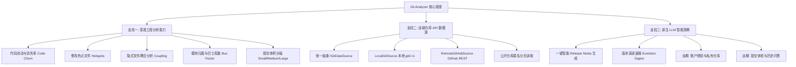

# Git Analyzer 增强与架构重塑方案

状态：本轮可落地范围已实现；账户授权与私有仓库列入远期  
模块路径：[`src/tools/git-analyzer`](src/tools/git-analyzer/ARCHITECTURE.md:1)  
目标：增强本地 Git 工程指标、项目级 LLM 洞察，并支持匿名读取 GitHub 公开仓库。用户账户授权、私有仓库访问和 OAuth 凭据存储保留为远期评估。

---

## 1. 现状剖析与痛点

现有工具已具备本地 Git 历史读取、基础统计、图表和报告导出。本轮补齐工程指标、LLM 洞察及 GitHub 公开仓库匿名读取；行数和文件明细按数据源能力明确标注覆盖范围。

---

## 2. 核心架构设计



### 2.1. 支柱一：深度工程度量 (Deep Git Analytics)

在 [`useGitProcessor.ts`](src/tools/git-analyzer/composables/useGitProcessor.ts:1) 与 [`useCharts.ts`](src/tools/git-analyzer/composables/useCharts.ts:1) 中扩展纯函数计算：

1. **热点文件与代码流失率 (Hotspots & Code Churn)**：
   - 指标：`Churn = Additions + Deletions`，按文件聚合修改次数与代码变更量；
   - 视图：Top 10 爆改热点文件横向柱状图 / 散点气泡图（X 轴为修改频次，Y 轴为累计改动行数）；
   - 作用：识别频繁重构、可能存在设计坏味道的脆弱模块。
2. **提交体积分级 (Commit Size Distribution)**：
   - 划分阶梯：微型（<30 行）、小型（30–99 行）、中型（100–299 行）、大型（300–999 行）、巨型（≥1000 行）；
   - 作用：度量团队开发风格与代码审查友好度。
3. **历史变更贡献集中度 (Change Concentration，后续)**：
   - 按目录/模块汇总贡献者历史增删行数占比，标注为历史变更贡献，不直接等同于当前代码所有权；
   - 真正的代码所有权与 Bus Factor 需要基于当前代码 blame 行数，并定义作者归一化、重命名和时间窗口规则，作为后续能力评估。
4. **隐式模块耦合度 (Temporal Coupling，后续)**：
   - 统计同一提交内共同变更的文件对；可用 `共同变更提交数 / 至少涉及其中一个文件的提交数` 作为 Jaccard 相似度；
   - 与 Code Maat 的 coupling 度量口径并不相同，界面需说明所用公式和统计范围。

---

### 2.2. 支柱二：远端仓库 API 数据源 (Remote / Zero-Clone Mode)

#### 数据源抽象协议
```typescript
export interface IGitDataSource {
  id: string;
  type: "local" | "github" | "gitlab";
  getBranches(): Promise<GitBranch[]>;
  getCommits(
    options: StreamLoadOptions,
    onProgress?: (event: GitProgressEvent) => void
  ): Promise<void>;
  getCommitDetail(hash: string): Promise<GitCommit>;
  getRemoteInfo?(): Promise<{ stars?: number; forks?: number; description?: string }>;
}
```

- **`LocalGitDataSource`**：封装既有 Rust `git2-rs` 驱动的 [`git_load_repository_stream`](src-tauri/src/commands/git_analyzer.rs:326)；
- **`GitHubApiDataSource`**：
  - 支持解析 GitHub URL（如 `https://github.com/vuejs/core`）或缩写 `vuejs/core`；
  - 首期使用 GitHub REST API；提交列表 `per_page` 上限为 100，提交详情按需请求。单次提交涉及超过 300 个文件时，响应通过分页提供文件列表，最多覆盖 3,000 个文件；
  - **限额策略**：公开读取按 GitHub REST 匿名限额设计（通常为每小时 60 次）；读取 1000 条提交最多需要 10 页列表请求，另有仓库元数据请求。遇到限额错误提示用户稍后重试；限额可能随 GitHub 策略调整；
  - **按需拉取**：分批加载提交列表与摘要，点击详情时再拉 diff，避免全量获取文件详情；
  - 先支持 GitHub.com；GitHub Enterprise Server 作为独立兼容性范围评估。

#### 远期：用户账户认证与私有仓库

后续可评估由用户使用自己的 GitHub 账户授权 AIO Hub，以访问私有仓库并获得更高 API 限额。建议注册 GitHub App，并仅申请仓库 `Metadata: read` 与 `Contents: read` 权限。令牌最终可访问范围同时受用户权限、App 权限和仓库安装/授权范围约束；访问私有仓库前，需确认 GitHub App 已安装到对应个人账户或组织并获准访问目标仓库，组织也可能要求管理员审批。该能力本轮不实现。

- **桌面授权流程**：优先验证系统浏览器中的 Authorization Code + PKCE。由 Tauri 后端生成并校验一次性 `state` 和 PKCE verifier，通过仅监听回环地址的临时回调接收授权码，再完成令牌交换。回调只传 authorization code，不在 URL 或深链中传递 access/refresh token；实现前需验证 GitHub App 回调 URL 对本机临时端口的约束及 Windows、macOS、Linux 上的监听生命周期。
- **客户端密钥边界**：GitHub 文档说明原生/公开客户端无法保密 client secret，客户端需要携带它并使用 PKCE。因此将 client secret 视为可提取的公开客户端配置，PKCE 用于降低授权码被截获后的风险；它不构成应用后端的身份认证。GitHub App private key 不得打包进客户端。
- **备用流程**：GitHub App Device Flow 支持桌面应用，但 GitHub 提醒其缺少绑定回调地址的保护，存在钓鱼冒用风险。只有 PKCE 回环流程无法落地时再评估启用，并明确展示 GitHub 官方验证地址和用户码。
- **令牌生命周期与保存**：GitHub App 用户令牌支持过期和刷新；access token、轮换后的 refresh token 需要保存在操作系统凭据库。项目目前没有供业务模块使用的跨平台通用 SecretStore：`llm-secret` 是配置文件混淆存储，`web_distillery` 的 DPAPI/Keychain/Secret Service 实现仅服务 Cookie，并包含兼容明文的路径，均不适合作为 OAuth 令牌库。本轮仅提供匿名访问；账户会话与凭据保存随远期认证能力一并设计。
- **平台验证**：首期只承诺 GitHub.com REST API。代理环境、系统浏览器回调、授权撤销、令牌刷新、跨平台安全存储均需在远端源实施阶段验证。认证按托管平台拆分适配器；GitLab、Bitbucket 和 GitHub Enterprise Server 的授权与 API 兼容性后续分别评估，不能复用 GitHub token 作为通用仓库凭据。

---

### 2.3. 支柱三：无缝接入 LLM 基础设施 (AI Insights)

调用项目统一基础设施：
- [`useLlmRequest`](src/composables/useLlmRequest.ts:1) 负责请求发送（流式 + AbortSignal）；
- [`useLlmProfiles`](src/composables/useLlmProfiles.ts:1) 与 [`LlmModelSelector`](src/components/common/LlmModelSelector.vue:1) 负责模型与渠道选择。

当前已新增 **「AI 洞察」** Tab：支持按当前筛选范围生成 Release Notes 或演进摘要，使用项目模型选择器与 LLM 请求中间件。单次最多发送 200 条提交摘要，并向用户说明所选模型服务会接收这些数据。

提交体检、历史会话问答和自动版本标签推断留作后续能力。

### 2.4. 现成方案与依赖复用调研

调研时间：2026-10-23。结论是复用项目现有 Git/API/图表基础设施，外部分析器作为指标与结果参照，不把独立 CLI/JAR/Python 工具嵌入桌面运行链路。

| 方案 | 可借鉴能力 | 与本项目的适配结论 |
| :--- | :--- | :--- |
| [`git2-rs`](https://github.com/rust-lang/git2-rs) | 本地提交遍历、diff 与行数统计 | 当前 Rust 后端已使用 `git2 0.20`，沿用现有实现并补齐所需统计字段；远端 GitHub API 不需要通过 clone 替换它。 |
| [`Code Maat`](https://github.com/adamtornhill/code-maat) | Churn、耦合、作者/模块历史分析等度量思路 | Clojure 命令行分析器，适合作为公式和样例仓库的离线对照；不作为桌面运行时依赖。尤其要区分其 coupling degree 与本计划的 Jaccard 口径。 |
| [`git-of-theseus`](https://github.com/erikbern/git-of-theseus) | 按代码行追踪存活、流失和历史归属 | Python CLI，可用于验证历史演进和归属分析思路；不要求用户安装 Python，也不放入应用运行链路。 |
| [`git-cliff`](https://git-cliff.org/) | 按规则从 Git 历史生成 changelog，支持 Conventional Commits 风格 | 可作为规则化 Release Notes 的算法/格式参照。提交信息规范时可确定性分类；普通提交语义仍由 LLM 总结。首期不引入外部进程。 |
| [`Octokit.js`](https://github.com/octokit/octokit.js) | GitHub REST 类型化接口、分页插件、自定义 fetch | 本轮未引入。当前端点仅涵盖仓库元数据、提交列表和按需提交详情，采用 `@tauri-apps/plugin-http` 实现窄 REST client，减少依赖并控制匿名分页请求。 |
| 项目现有基础设施 | `git2 0.20`、ECharts、Tauri `plugin-http`；`isomorphic-git` 已列为前端依赖 | 图表与本地分析直接复用。`isomorphic-git` 面向 JS Git 操作，当前本地分析由 Rust/libgit2 驱动，远端模式又以 GitHub API 为主，不建议为本次增强替换核心链路。 |

参考入口：
- GitHub REST 提交 API：[提交列表与详情](https://docs.github.com/en/rest/commits/commits)；[REST API 限额](https://docs.github.com/en/rest/using-the-rest-api/rate-limits-for-the-rest-api)。
- GitHub App：[生成用户访问令牌与 PKCE / Device Flow](https://docs.github.com/en/apps/creating-github-apps/authenticating-with-a-github-app/generating-a-user-access-token-for-a-github-app)；[应用安全最佳实践](https://docs.github.com/en/apps/creating-github-apps/about-creating-github-apps/best-practices-for-creating-a-github-app)；[安装 GitHub App](https://docs.github.com/en/apps/using-github-apps/installing-your-own-github-app)；[选择权限](https://docs.github.com/en/apps/creating-github-apps/registering-a-github-app/choosing-permissions-for-a-github-app)；[刷新用户访问令牌](https://docs.github.com/en/apps/creating-github-apps/authenticating-with-a-github-app/refreshing-user-access-tokens)。
- 度量和 changelog：[Code Maat](https://github.com/adamtornhill/code-maat)、[git-of-theseus](https://github.com/erikbern/git-of-theseus)、[git-cliff](https://git-cliff.org/)；API SDK：[Octokit.js 分页文档](https://github.com/octokit/octokit.js/blob/main/_autodocs/api-reference/paginate.md)。

---

## 3. 本轮实施结果

实现采用现有本地 Runner 与窄 GitHub REST adapter 分工，`IGitDataSource` 保留为后续统一接口设计。当前提交详情最多读取 100 条文件明细，超出部分以覆盖状态提示。

- 来源选择：将「本地 / GitHub」下拉合并到仓库输入区域左侧，保留本地拖放与选择目录入口。

- 本地工程指标：新增代码流动量、按文件修改频次排序的热点、提交体积分级；指标页显示统计覆盖率，缺失行数时可触发本地提交补充。
- 公开仓库：支持 GitHub URL 或 `owner/repo`，匿名读取默认分支或输入分支的提交列表；提交列表每页最多 100 条，单次最多读取最近 1000 条，仓库提交详情按需请求。公开列表未逐条请求 diff，因此未读取的行数/文件统计显示为未加载。
- LLM 洞察：根据筛选后的提交摘要生成 Release Notes 或演进摘要，支持取消，提交数据仅按当前操作发送至用户选择的模型服务。
- 远期范围：GitHub 账户认证、私有仓库、令牌刷新与安全持久化、GitLab/Enterprise、Bus Factor、当前代码所有权、耦合分析、跨会话仓库问答。

## 4. 分阶段实施路线图

| 阶段 | 核心任务 | 状态 | 后续边界 |
| :--- | :--- | :--- | :--- |
| **Phase 1: 工程指标** | 本地 Churn、文件热点、提交体积分级及数据覆盖状态 | 已实现 | 耦合、当前代码所有权和 Bus Factor 另行定义口径 |
| **Phase 2: LLM 洞察** | Release Notes、演进摘要、模型选择和取消生成 | 已实现 | 提交体检与历史问答后续评估 |
| **Phase 3A: 公开仓库读取** | GitHub REST 匿名分页、仓库元数据、默认/输入分支、按需提交详情 | 已实现 | 公开 API；最多最近 1000 条；详情按需读取 |
| **Phase 3B: 用户账户** | GitHub App 授权、私有仓库、令牌刷新和操作系统凭据库 | 远期计划 | 先验证 PKCE 回环流程、平台凭据库与组织授权边界 |

## 5. 验证记录（2026-10-23）

- Git Analyzer 相关测试：5 个文件、22 项通过；类型检查与 Vite 生产构建通过。
- 真实 Tauri 窗口：来源下拉切换、本地 100 条提交加载与工程指标补齐已完成走查，行数统计覆盖 100/100。
- GitHub 模式布局和输入已走查；实际 API 请求返回匿名额度耗尽，成功读取公开仓库与详情的运行态验证待额度恢复后补充。
- LLM 请求链路已接入现有模型服务，真实模型输出尚未验证。
