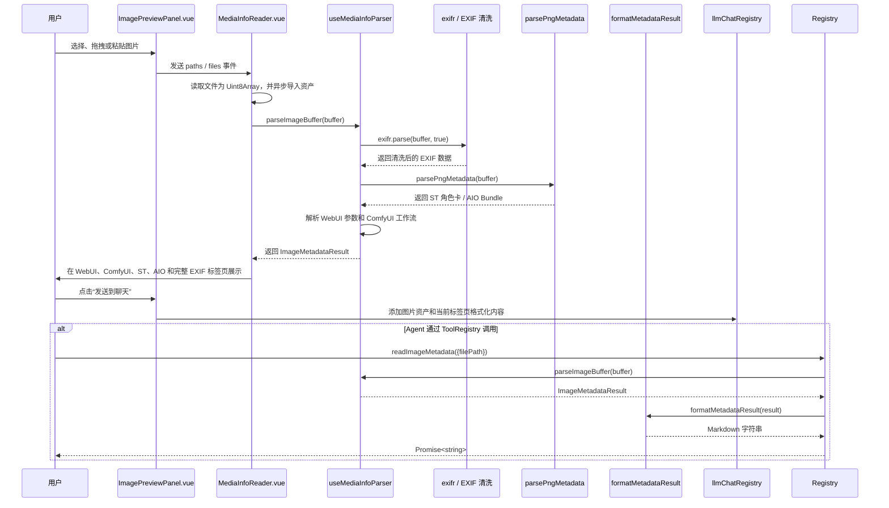

# Media Info Reader: 架构与开发者指南

本文档旨在解析 Media Info Reader 工具的内部架构、设计理念和数据流，为后续开发提供清晰的指引。

## 1. 核心概念

Media Info Reader 是一个专为 AI 生成图片和 AIO 角色包设计的元数据提取器，旨在从多种主流工具生成的图片中提取 Prompt、生成参数、工作流、角色卡和 AIO Bundle 信息。工具同时提供面向 UI 的结构化结果和面向 Agent 的 Markdown 格式化结果。

### 1.1. 分层解析策略 (Layered Parsing Strategy)

为了最大化兼容性，工具采用分层、递进的解析策略，以适应不同工具的元数据存储方式。

- **EXIF 解析 (通用)**: 使用 `exifr` 库解析标准的 EXIF 数据，并对 `UserComment` / `parameters` 等字段进行编码清洗，作为 WebUI、ComfyUI 和完整 EXIF 信息的基础。
- **PNG Chunk 解析 (底层)**: 使用 `parsePngMetadata()` 手动读取 PNG 特殊元数据，提取 SillyTavern 角色卡和 AIO Bundle。
- **AIO Bundle 解包**: 对压缩的 `AIO_Agent_Bundle` 解码并使用 `JSZip` 查找 `.agent.json` 或 `.agent.yaml` / `.agent.yml` 清单；无法解包时保留 Bundle 原始内容作为回退结果。
- **WebUI 参数解析**: 针对 A1111/Forge WebUI 将参数存储在单一字符串中的情况，通过字符串分割和正则表达式提取正向 Prompt、负向 Prompt、生成参数及 Civitai 资源。
- **ComfyUI 工作流解析**: 从 EXIF 的 `workflow` 字段读取工作流，优先解析为 JSON 对象，无法解析时保留原始字符串。

### 1.2. 关注点分离与支持矩阵

解析器返回统一的 `ImageMetadataResult`，UI 和 Agent 共享解析结果，但各自负责不同的呈现和传输职责。

| 来源 / 能力 | 解析结果 | UI 展示 | Agent 格式化输出 |
|---|---|---|---|
| Stable Diffusion WebUI / A1111 / Forge | 正向 Prompt、负向 Prompt、生成参数、Civitai 资源 | WebUI 标签页 | Markdown 的 WebUI 信息段落 |
| ComfyUI | 完整 JSON 工作流或原始字符串 | ComfyUI 工作流标签页 | JSON 代码块 |
| SillyTavern 角色卡 | 角色信息对象 | ST 可视化 / ST 源码标签页 | 清洗后的 JSON 代码块 |
| AIO Bundle | JSON 或 YAML Agent 清单，也支持原始 Bundle 回退 | AIO 可视化 / AIO 源码标签页 | JSON / YAML 代码块 |
| EXIF | 完整原始元数据 | 完整元数据标签页 | 可展开的 EXIF 摘要 |

## 2. 架构概览

- **View (`MediaInfoReader.vue`)**: 负责 UI 编排，包括文件选择、路径和文件拖放处理、图片预览、解析结果标签页以及“发送到聊天”操作。发送入口位于 `ImagePreviewPanel.vue`，事件由页面处理并根据当前标签页将元数据与图片资产写入 `llmChatRegistry`。
- **Registry Facade (`MediaInfoReaderRegistry`)**: `media-info-reader.registry.ts` 的默认导出类，实现 `ToolRegistry`。作为工具注册门面，提供 `readImageMetadata(args)` 和 `parseImageBuffer(buffer)` 两个入口；前者读取文件路径并调用格式化器，后者供应用内部直接取得结构化解析结果。
- **Logic (`useMediaInfoParser`)**: 独立的 Composable，封装 EXIF 清洗、PNG Chunk 解析、AIO Bundle 解包、WebUI 参数解析和 ComfyUI 工作流解析，返回统一的 `ImageMetadataResult`。
- **Formatter (`formatMetadataResult`)**: 将 `ImageMetadataResult` 转换为面向 Agent 的 Markdown 文本，覆盖 WebUI、ComfyUI、SillyTavern、AIO Bundle 和 EXIF 信息；`sanitizeForAgent()` 会截断大型 Base64 数据，避免无关二进制内容污染 Agent 上下文。
- **Components**: `ImagePreviewPanel.vue` 负责预览、文件入口和发送事件；`WebUIInfoTab.vue`、`AioBundleInfoTab.vue`、`StCharacterInfo.vue` 及代码编辑器区域负责各类结果展示。组件不直接承担通用解析逻辑。
- **Engine (`exifr`、`parsePngMetadata`、`JSZip` & Custom Parsers)**: 底层解析和解包依赖，包括 EXIF 解析库、PNG 元数据读取器、AIO Bundle 解压器及 WebUI 自定义解析器。

`MediaInfoReaderRegistry.readImageMetadata()` 面向 Agent 的返回值是 `Promise<string>`：成功时返回结构化 Markdown，失败时返回可读的错误文本，而不是原始 `ImageMetadataResult`。`parseImageBuffer()` 则保留 `Promise<ImageMetadataResult | null>`，供 UI 和其他应用内部调用。

## 3. 数据流：解析一张图片

## 4. 未来展望

- **新增工具支持**: 持续跟进社区，为更多新兴的 AI 绘图工具添加专门的解析器。
- **支持更多格式**: 在已有 PNG/JPG/WebP 入口的基础上，扩展更多图片与打包格式的元数据提取。
- **格式健壮性**: 增强 WebUI 参数解析器的健壮性，以应对未来可能出现的格式变化。
