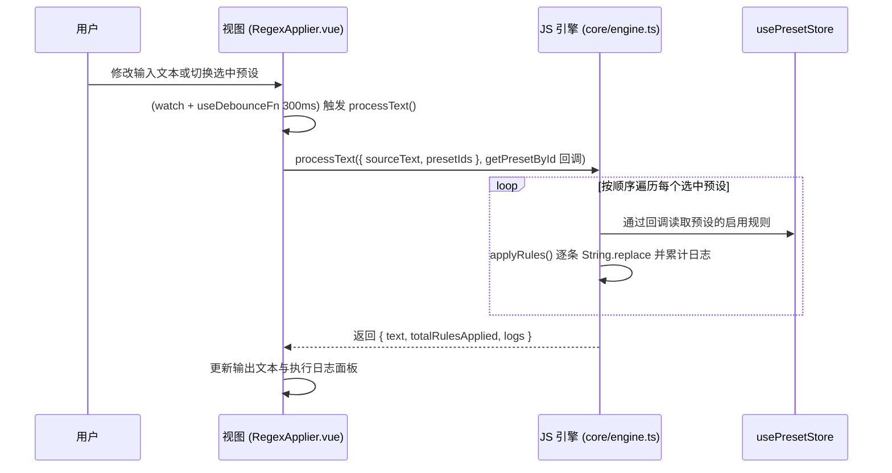
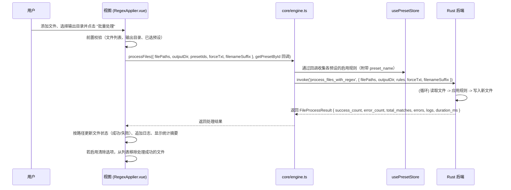

# Regex Applier: 架构与开发者指南

本文档旨在解析 Regex Applier 工具的内部架构、设计理念和数据流，为后续开发提供清晰的指引。

## 1. 核心概念

Regex Applier 是一个批量正则表达式处理工具，其核心是 **双引擎架构**，兼顾了实时交互预览和高性能的批量文件处理能力。

### 1.1. 双引擎架构 (Dual-Engine Architecture)

- **前端引擎 (JavaScript)**:
  - **目的**: 提供流畅的 **实时预览**。当用户在 UI 中修改输入文本或规则时，该引擎会在浏览器端立即执行正则替换。
  - **实现**: 通过 `watch` 和 `debounce` (300ms) 机制，调用 JS 的 `String.prototype.replace()`。
  - **限制**: 受浏览器性能限制，不适合处理超大文本或大量文件。

- **后端引擎 (Rust)**:
  - **目的**: 提供高性能的 **批量文件处理**。用户可以将规则应用于整个目录，由后端完成读写操作。
  - **实现**: 通过 Tauri `invoke` 调用 `process_files_with_regex` 命令。Rust 后端会遍历文件、读取内容、应用规则并写入新文件。
  - **优势**: 性能远超前端，能够高效处理大量文件和大型文本，且不阻塞 UI。

### 1.2. 规则链与预设 (Rule Chain & Presets)

与纯前端版本类似，工具的核心是规则链和预设系统。用户可以创建、保存、导入/导出包含多条正则表达式的预设，便于复用和分享。

### 1.3. 正则兼容性检查 (Regex Compatibility Check)

由于 JavaScript 和 Rust 的正则表达式引擎存在语法差异（如 Rust 不支持前瞻/后瞻断言），工具内置了一套兼容性检查机制。

- **核心命令**: 在预设管理器（`PresetManager.vue`）中编辑或保存规则时，前端调用 `validate_regex_pattern` 命令校验单个规则。
- **校验逻辑**: Rust 后端会尝试编译规则，并返回一个包含 `isValid`、`errorMessage` 和 `warning` 的结果。
- **UI 反馈**: 预设管理器根据校验结果，在规则旁边显示警告或错误图标，提前告知用户哪些规则无法在后端批量处理时使用。

## 2. 架构概览

- **View (`RegexApplier.vue`)**: 负责 UI 渲染与用户交互，并直接编排执行：维护输入/输出文本、执行日志、文件列表与运行配置（`AppConfig`，经 `appConfigManager` 持久化），监听输入变化（防抖 300ms）触发文本预览，并在点击"批量处理"时调用引擎处理文件。
- **State (`usePresetStore`, `stores/store.ts`)**: 预设专用的 Pinia Store，只负责预设与规则的管理：预设/规则的增删改、排序、启用切换、导入导出与激活预设切换，并通过 `presetsConfigManager` 防抖持久化。不持有输入/输出文本或执行日志。
- **Core Engine (`core/engine.ts`)**: 纯逻辑层，不依赖 UI 框架与 Pinia。提供 `applyRules()`（单文本应用规则链）、`processText()`（按预设顺序处理文本）、`processFiles()`（调用 Rust 后端处理文件）、`validateRegex()` 与 `parseRegexPattern()`。通过 `getPresetById` 回调函数解耦 Store，由调用方注入预设查询。
- **Registry (`regex-applier.registry.ts`)**: 面向 Agent / 外部调用的门面，封装 `engine.processText()` / `processFiles()` / `validateRegex()` 并负责 Store 的懒初始化。
- **Rust 后端**: `validate_regex_pattern` 命令（规则兼容性校验）与 `process_files_with_regex` 命令（高性能批量文件处理）。

## 3. 数据流

执行由视图直接编排：视图从 `usePresetStore` 读取用户选中的预设（`selectedPresetIds`），以回调 `(id) => store.presets.find((p) => p.id === id)` 的形式把预设查询注入引擎。

### 3.1. 场景一：单文本处理（`processText`）

视图中的"一键处理"走同一链路：从剪贴板读取文本 → 调用 `engine.processText()` → 将结果写回剪贴板。

### 3.2. 场景二：多文件批量处理（`processFiles`）

## 4. 未来展望

- **统一引擎**: 探索使用 WebAssembly (WASM) 编译 Rust 的 `regex` crate，以统一前后端的正则引擎，消除兼容性问题。
- **性能优化**: 针对超大文本（>10MB）的实时处理，探索性能优化方案，如增量处理或 Web Worker。
