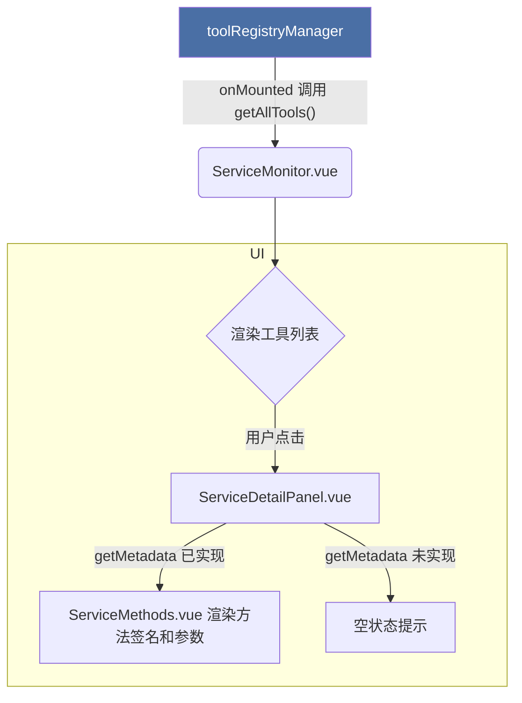

# Service Monitor: 架构与开发者指南

本文档旨在解析 Service Monitor 工具的内部架构与设计理念，为开发调试提供指引。

## 1. 核心概念

Service Monitor 是一个工具注册中心的可视化监控工具，旨在为开发者提供一个清晰的应用内部工具 API 视图。

- **核心目的**:
  - **工具发现**: 自动从全局 `toolRegistryManager` 读取并列出所有已注册的 `ToolRegistry`。
  - **API 文档**: 可视化展示每个工具的元数据，包括其 ID、名称、描述以及所有公开方法的详细签名（参数、返回类型、示例等）。
  - **开发辅助**: 帮助开发者快速了解系统中可用的工具及其能力，降低模块间协作的门槛。

> 工具注册体系的完整规范（`ToolRegistry` 类、`toolConfig`、`getMetadata()` 编写格式等）见[工具注册指南](../../../docs/guide/tool-registry-guide.md)。

## 2. 架构概览

工具采用一个简单的、**只读**的架构，直接与工具注册中心交互。

- **View (`ServiceMonitor.vue`)**: 负责 UI 渲染。组件在挂载时 (`onMounted`) 调用 `toolRegistryManager.getAllTools()` 获取所有工具实例，并将其渲染为两栏布局（左侧为工具列表，右侧为选中工具的详情）。
- **Detail View (`components/ServiceDetailPanel.vue`)**: 接收选中的 `ToolRegistry`，展示基本信息（ID、名称、描述），并检测该工具是否实现了 `getMetadata()`；已实现时将方法列表交给 `ServiceMethods.vue` 渲染，未实现时展示空状态提示。
- **Data Source (`toolRegistryManager`)**: 全局单例的工具注册管理器（`src/services/registry.ts`），是此工具的唯一数据来源。它负责工具的注册、初始化与注销，并通过工厂（`ToolRegistryFactory`）支持插件等动态工具的注册。
- **Data Contract (`ToolRegistry` interface)**: 所有被监控的工具都必须实现 `ToolRegistry` 接口（`src/services/types.ts`）；可选实现的 `getMetadata()` 方法（返回 `ServiceMetadata`）定义了需要向监控器展示的方法签名等元数据结构。工具是否实现该方法由监控器在运行时检测。

## 3. 数据流

## 4. 未来展望

- **实时监控**: `toolRegistryManager` 已提供 `subscribe()` 变更订阅机制，可在此工具中接入，使监控器实时响应工具的注册与注销。
- **方法调用**: 增加一个交互式表单，允许开发者直接在监控器中输入参数并调用工具方法，查看返回结果，将其转变为一个动态的 API 测试工具。
