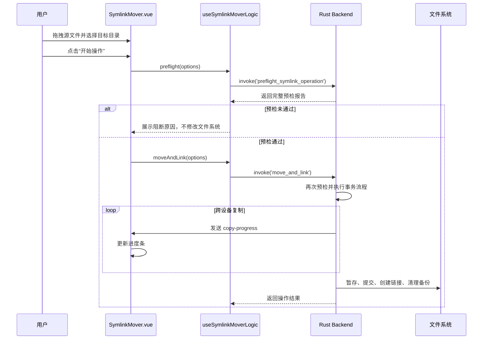

# Symlink Mover: 架构与开发者指南

本文档旨在解析 Symlink Mover 工具的内部架构、设计理念和数据流，为后续开发提供清晰的指引。

## 1. 核心概念

Symlink Mover 是一个文件“搬家”工具，旨在通过移动文件并在原位置创建链接的方式，帮助用户在不破坏程序路径依赖的前提下，重新组织磁盘空间。

### 1.1. 双操作模式 (Dual Operation Modes)

工具提供了两种核心操作模式，以适应不同的使用场景。

- **搬家模式 (`move-and-link`)**:
  1. 将源文件/目录移动到新的目标位置。
  2. 在源文件/目录的原始位置创建一个指向新位置的链接。
  - **用途**: 解决 C 盘空间不足等问题，将大文件（如模型、游戏）迁移到其他磁盘，同时保持软件的正常访问。

- **仅创建链接模式 (`link-only`)**:
  1. 源文件/目录位置保持不变。
  2. 在指定的目标目录中创建一个指向源文件/目录的链接。
  - **用途**: 创建一个集中的快捷访问点，将散落在各处的文件/目录聚合到一个地方。

### 1.2. 双链接类型 (Dual Link Types)

支持两种不同类型的链接，各有优劣。

- **符号链接 (Symlink)**:
  - **优势**: 支持文件和目录，支持跨分区/跨盘符。
  - **类比**: 一个记录了目标路径的“快捷方式”。删除源文件后，链接会失效。

- **硬链接 (Hard Link)**:
  - **优势**: 多个文件入口指向同一份物理数据。删除任意一个入口，只要还存在其他入口，文件数据就不会丢失。
  - **限制**: **仅支持文件**，且**不能跨分区/跨盘符**。

### 1.3. Rust 后端驱动与安全校验

核心算法位于 `src-tauri/src/symlink_mover.rs`，Tauri 命令适配层与 Electron N-API 共用；进度和日志类型位于 `src-tauri/src/file_operation_types.rs`。所有文件系统操作均由 Rust 后端执行。前端的字段校验只用于即时提示，不能代替后端预检；执行命令会在真正写入前再次生成计划。

- **完整预检**: `preflight_symlink_operation` 一次检查源路径、镜像映射、目标冲突、目录写入权限、源目录中的嵌套链接、源路径重叠、目标路径逃逸、链接类型限制、跨设备情况以及目标磁盘剩余空间（空间/权限前置检查）。
- **执行前可移出检查**: `move_and_link` 在跨设备复制前额外用临时同目录改名往返探测源路径是否可移出，尽量在复制前发现“文件正在使用/权限不足”。Windows 文件锁和 ACL 可能在检查后变化，提交阶段继续保留回滚。
- **两阶段搬家与事务性回滚校验**:
  - 同盘使用 `rename -> 创建链接`；
  - 跨盘使用 `临时目录复制 -> 类型/大小校验 -> 源路径备份改名 -> 提交目标 -> 创建链接`。
  - 任何中间步骤（如目标提交失败、创建链接失败）都会触发事务性回滚，自动恢复源路径备份并清理临时复制产物。
- **清理失败不丢数据**: 搬家完成后备份移入回收站失败时，不删除源数据，保留备份并在日志中写入 warning。
- **进度监听**: 对于跨设备文件复制，共享核心通过回调上报复制进度，由宿主适配层发送 `copy-progress` 事件。

## 2. 架构概览

- **View (`SymlinkMover.vue`)**: 负责 UI 渲染和用户交互，包括文件拖拽、参数选择和结果展示。
- **Service (`useSymlinkMoverLogic`)**: 提供高级、无状态的 API，封装了与 Rust 后端的交互逻辑和校验流程。
- **Engine (Rust Backend)**: 负责执行实际的文件移动、链接创建、校验和进度上报。

## 3. 数据流：执行一次“搬家”操作

## 4. 核心逻辑

- **操作日志**: 每次操作都会在 Rust 后端自动保存一条详细的日志（包含操作类型、文件数量、耗时、错误等），并提供 API (`getOperationHistory`) 供前端查询。

## 5. 当前边界

- 预检是尽力而为的能力检查，无法保证操作开始后不会有其他进程抢占文件或改变 ACL；因此后端仍把所有提交步骤当作可能失败处理。
- 取消操作不会打断底层系统调用，但会在复制阶段结束后停止继续处理；当前条目会清理暂存并保持源路径可恢复，已经提交成功的条目不会自动跨条目回滚。
- Windows Junction / reparse point 仍按链接边界拒绝，后续如支持需要单独设计其识别、复制和回滚策略。

## 平台路径比较

预检中的重复、嵌套和目标边界检查共用原生 `Path` 组件比较。Windows 保留原有 ASCII 大小写折叠；Unix 保留文件名大小写、反斜杠及原始路径字节。这样可以区分 `parent/child` 与同级的 `parent\child`，同时继续阻断真实嵌套源和目标逃逸。

## 6. Electron 宿主

- `electron/symlink-mover.ts` 接入单个/批量文件验证、完整预检、搬移并链接、仅创建链接、取消和最新/全部日志八个命令。原生入口位于 `native/knowledge-addon/src/symlink_mover.rs`，沿用统一 `knowledge-addon.node` 构建。
- 全应用同时接受一个写操作；运行中的任务占用槽位，其他窗口收到等待提示。请求在接收时快照，文件和参数控件从预检起锁定。执行前重新生成计划，目标冲突阻止整个批次进入写入。
- 一次性 runtime 持有独立取消令牌；取消校验窗口归属及可选 `operationId`。进度只投递给所属窗口，队列最多保存 128 条进度，繁忙时保留较新的进度；操作结果和日志通过调用回复完整返回。
- 文件与目录复制沿用已有 fs_extra 调用。取消等待当前复制返回，随后清理暂存并保留源路径；已提交成功的其他条目保持完成状态。导航、刷新、关窗和退出触发同一收尾，应用退出等待原生任务完成。只读查询在窗口释放后失效。
- Electron 共享保存最近 100 条操作历史，各窗口优先读取自己的最新完成记录，避免并发窗口的日志覆盖当前操作反馈；首次进入时可查看已有最新历史。日志保持当前进程内存生命周期，与 Tauri 原有持久化边界一致。
- 源、目标和基准路径检查全部现有祖先的符号链接及 Windows reparse point。源目录中的嵌套链接拒绝进入复制；批量源按完整父子组合检查重叠。硬链接与镜像路径规则继续由共享预检验证。
- 前端通过原生确认的成功路径更新逐项状态，取消后未完成项保留为待处理；异步验证使用代计数器，已移除的文件保持移除。监听注册、操作调用和工具释放共同校验生命周期，迟到进度随任务身份过滤。KeepAlive 停用时取消并解绑，激活时恢复监听，页面缓存中的文件列表继续保留。

实施与真实 Windows 验证进度见[Electron 功能缺口补齐待办](../../../docs/Plan/electron-feature-gap-execution.md)。
